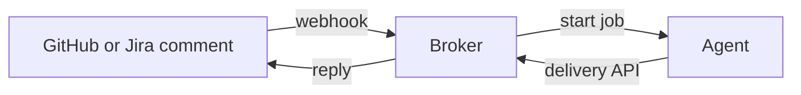

# slop-code-factory

A learning project. It shows how a GitHub comment or Jira comment reaches a long-running agent, and how the answer returns.

The `effect-channels` SDK is the broker. The agent is an echo stub. A useful agent is not a goal.

## Flow

## Status

| Part | State |
|---|---|
| Cloudflare broker | Built. Tests pass. |
| AWS control layer | Built. Tests pass. |
| Azure control layer | Built. Tests pass against fakes. Not deployed. |
| Portal prototype | Built. Some parts are simulated. |
| Real agent (Pi) | Not built. |

## Layout

| Path | Contents |
|---|---|
| `packages/core` | Shared bot logic. No cloud imports. |
| `infra/cloudfare` | Cloudflare broker. The folder name keeps its original spelling. |
| `infra/aws` | AWS control layer (Terraform). |
| `infra/azure` | Azure control layer (Terraform). |
| `channels/github-app` | GitHub App setup. |
| `agents/pi` | Placeholder for the real agent. |
| `portal-poc` | Portal prototype (Next.js). |
| `examples/copilot-sdk` | Copilot SDK scripts. Not related to the plan. |
| `docs` | Documents. Start at `docs/README.md`. |

## Read first

1. [`docs/purpose-and-scope.md`](docs/purpose-and-scope.md)
2. [`docs/architecture.md`](docs/architecture.md)
