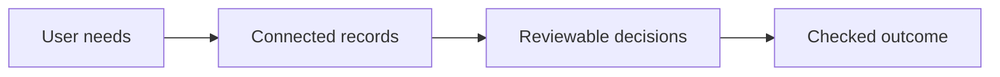
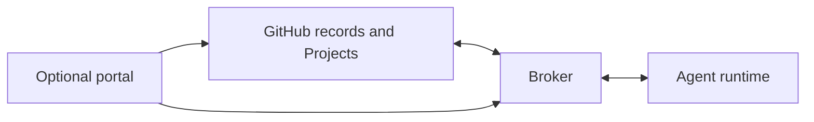
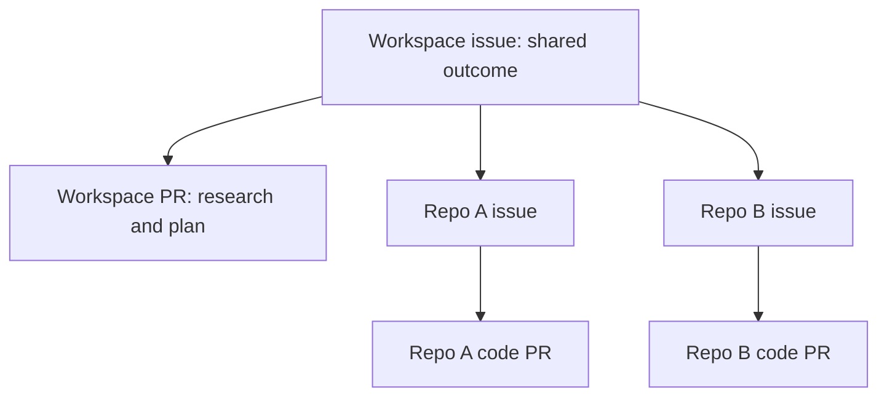
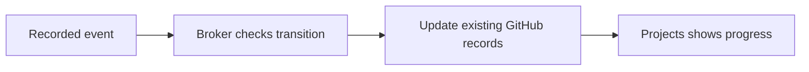

# 10 · Workflow and portal rationale

Date: 2026-11-06.

Status: documented design direction. Detailed approval and completion rules remain open.

## 1. The problem

Help users understand, authorise, and track agent work across repos.

A task can require changes in several repos. Users need one connected history of the requested outcome and its implementation.

## 2. Start with user needs

- Understand the problem across the affected repos.
- Inspect evidence and correct findings before implementation.
- Approve a specific scope and plan revision.
- Find the person or task that blocks progress.
- Review code in the repo that owns it.
- Confirm that the combined changes meet the requested outcome.

These needs require durable records, explicit relationships, review evidence, and visible progress.

They do not establish a need for a separate portal dashboard.

## 3. Design direction

Use GitHub issues, PRs, and Projects as the shared record of work and review.

Use a workspace repo for shared configuration, research, and plans.

Use target repos for implementation issues, code changes, and code reviews.

The broker coordinates agent work and updates GitHub records. GitHub Projects provides task visibility.

Keep the portal supplementary. Add features when users have needs that the existing process does not meet.

Supplementary means that the portal uses the same work records. It does not require a second task database or approval system.

## 4. Why the workspace exists

A repo boundary does not always match a user problem.

The workspace connects the affected repos, their relationships, and their shared instructions.

Keeping this configuration in a repo makes changes reviewable and gives each configuration a revision.

Research and plans use this shared context. They must identify the source revisions used as evidence.

This is our storage choice. User needs alone do not require all research to use Git.

## 5. Why each step exists

### Step 1: Create a workspace issue

Record the requested outcome and acceptance criteria in one parent issue.

Why: users need a stable reference while the task expands across repos.

If Jira supplied the request, link that request to the workspace issue. Final status ownership remains an open decision.

### Step 2: Research in the workspace context

Record findings, evidence, affected repos, and uncertainty. Link the research record from the parent issue.

Why: implementation should follow inspected evidence rather than an untested assumption.

A separate research approval is not yet a fixed requirement.

### Step 3: Prepare and review the plan

Keep the plan in the workspace repo and submit it through a PR.

State the affected repos, intended changes, dependencies, acceptance checks, and proposed implementation order.

Why: reviewers need to evaluate the combined change before repo implementation begins.

Approval must identify a plan revision and authorised scope. The exact review and merge requirements remain open.

### Step 4: Create linked implementation issues

After plan approval, create an issue for each required repo task.

Link these issues as sub-issues of the workspace issue. Each issue must identify its approved plan revision and relevant requirements.

Why: repo maintainers need local ownership without losing the shared outcome.

Use dependency links when one task must finish before another. A parent relationship alone does not express execution order.

### Step 5: Implement and review in each repo

Link each code PR to its implementation issue and approved plan.

Why: code owners need to review changes within their own repo and permission boundaries.

Workspace plan approval does not replace code review in the target repos.

If new evidence changes the authorised scope, update the plan and request another decision.

The threshold for another approval remains open.

### Step 6: Validate the shared outcome

Check the combined result against the parent issue's acceptance criteria.

Why: completed repo tasks do not prove that the combined system meets the requested outcome.

Keep the parent open after plan approval. Define the completion rule before automating parent closure.

## 6. Progress and automation

Proposed stages: Research, Plan, Implementation, Validation, and Done.

Record conditions such as blocked, running, or waiting for review separately from the stage.

Choose one authoritative stage record: issue labels or a Project field. Derive other stage displays from that record.

Why: independently editable stage records can disagree.

The broker must use review evidence for approval transitions. A stage label alone does not prove authorisation.

Repeated events must find existing repo tasks. They must not create duplicate issues.

After a failure, compare the intended relationships with GitHub records and repair missing updates.

Why: automatic updates must preserve a coherent task history through retries and partial failures.

These are design requirements. This document does not claim that the broker implements them today.

## 7. Why a second dashboard needs evidence

GitHub Projects already provides issue progress and relationships. Repeating these records does not establish additional user value.

A portal can help with account connections, live run controls, or access for users outside GitHub.

These are candidate needs. Test whether issue comments, existing settings, and linked logs already meet them.

Add a portal feature when a demonstrated user task remains difficult.

Do not create separate progress or approval state for that feature.

## 8. Open decisions

- Does research require a separate approval?
- Does plan approval require a review, a merge, or both?
- Who can authorise scope that affects several repos?
- Which implementation changes require renewed approval?
- Do labels or Project fields own the task stage?
- Does completion require code merge, deployment, acceptance checks, or a defined combination?
- Which record owns final business status when Jira supplies the request?
- Who owns a task that spans several workspaces?

## 9. Validate the design

Run one task that changes two repos through the complete GitHub process.

Ask users to find the pending decision, blocking task, approved plan revision, and remaining acceptance checks.

Repair missing records or broker updates first. Use remaining difficulties to decide portal scope.

Why: a working example tests the process before we invest in additional screens.

## 10. Evidence and current limits

GitHub supports sub-issues from other repos. Projects can display parent relationships and sub-issue progress.

Source: [GitHub sub-issue documentation](https://docs.github.com/en/issues/tracking-your-work-with-issues/using-issues/adding-sub-issues).

GitHub supports Project automation through workflows, Actions, and its API.

Source: [GitHub Project automation documentation](https://docs.github.com/en/issues/planning-and-tracking-with-projects/automating-your-project).

GitHub supports issue dependencies for blocking relationships.

Source: [GitHub issue documentation](https://docs.github.com/en/issues/tracking-your-work-with-issues/learning-about-issues/about-issues).

The [portal README](../portal-poc/README.md) describes simulated research triggering, workflow progress, and workspaces.

This rationale extends the original plumbing scope. It records product direction rather than completed implementation.

