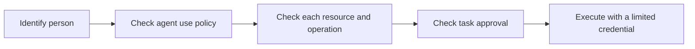
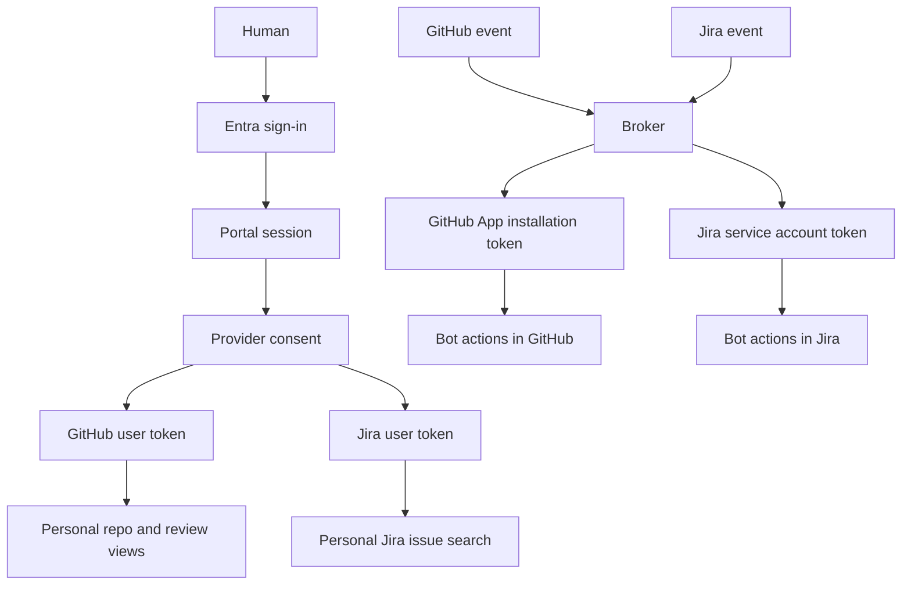
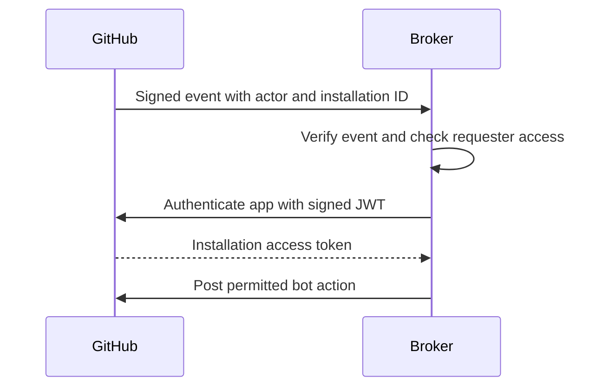
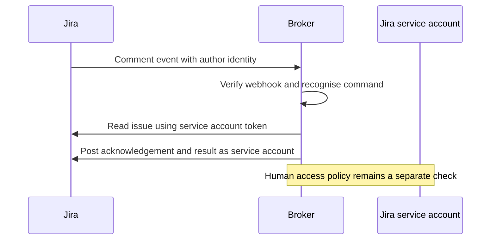
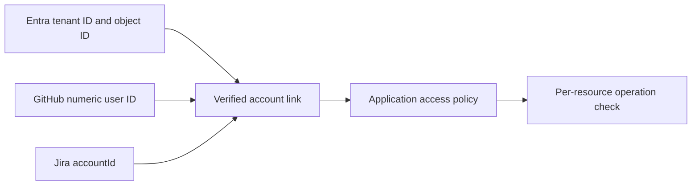

# 11 · Identity and integration risk review

Date: 2026-11-06.

Status: information and risk review draft. This document does not grant approval or change permissions.

For the subsequent credential-based checks, read the [live permission snapshot](12-live-integration-permissions.md).

That snapshot distinguishes confirmed grants from OAuth scopes that remain unverified.

The [workflow wiring review](13-broker-workflow-wiring.md) also identifies runner-side App credentials and Copilot authentication.

Audience: information security, platform owners, GitHub owners, Jira owners, and application owners.

## 1. Purpose and evidence boundary

Explain why each identity exists, how integrations use it, and what reviewers must approve.

This review uses repository code and current provider documentation. It does not inspect live app registrations or deployed secrets.

Actual app IDs, owners, grants, token expiry settings, and project access require confirmation in the admin consoles.

The [workflow rationale](10-workflow-and-portal-rationale.md) explains the intended research, planning, and implementation process.

The [provider setup guide](portal-provider-permissions.md) contains configuration details and callback URLs.

Evidence labels used below:

- **Implemented:** the reviewed code contains this behaviour. Deployment verification can still be pending.
- **Provider rule:** current official documentation describes this behaviour.
- **Proposed:** a recommended design or approval condition. Implementation is not established.
- **Confirm:** the reviewer needs deployment evidence or an explicit decision.

## 2. Start with four different questions

| Question | Mechanism | What it does not establish |
| --- | --- | --- |
| Who signed in? | Entra authentication | GitHub or Jira permissions |
| May this person use the agent? | Application access policy | Access to every connected repo or project |
| What can this credential access? | Provider permissions and token limits | Approval for this specific task |
| May the system perform this change now? | Task approval and operation policy | Additional provider permissions |

Authentication, provider consent, and task approval are separate decisions.

An installed GitHub App does not prove that a requester may use every repo accessible to that app.

A Jira service account does not inherit the comment author's access restrictions.

## 3. Identity inventory

| Identity or registration | Principal represented | Why it exists | Current evidence |
| --- | --- | --- | --- |
| Entra user | The human using the portal | Establish the organisation identity | Implemented portal sign-in |
| Entra portal app registration | The portal application | Receive sign-in responses and establish sessions | Implemented Auth.js configuration |
| Portal managed identity | The Azure workload | Authenticate the portal application without an Entra client secret | Implemented Azure configuration |
| Channel GitHub App | The automation bot | Receive events and post bot comments or reactions | Implemented broker integration |
| Portal GitHub App | App acting on behalf of a consenting user | Read the user's accessible installed repos and review requests | Implemented `app` mode |
| GitHub OAuth App | App acting on behalf of a consenting user | Alternative user access through broad OAuth scopes | Implemented `oauth` mode |
| Jira service account | The automation bot | Read issue context and post bot comments | Implemented Cloudflare channel path |
| Atlassian OAuth app | App acting on behalf of a consenting user | Read Jira issues using that user's permissions | Implemented portal connection |
| GitHub Actions workload | A workflow execution | Prove the origin of research result callbacks | Implemented Azure research callback path |

The channel and portal GitHub App roles are distinct in the setup documents.

Code alone cannot prove whether live deployments use separate registrations. Confirm the app IDs before approval.

One portal deployment selects either `app` or `oauth` through `GITHUB_AUTH_MODE`. Both modes are not required simultaneously.

## 4. System overview

The portal token store is not an implemented authorisation service for broker requests.

Linking an account in the portal does not currently establish an Entra policy check in either channel handler.

## 5. Entra: the human and application identities

### Why we use it

Entra provides the organisation sign-in identity. Provider account connections then attach GitHub and Jira access to that portal session.

An Entra ID token identifies the authenticated person. It cannot serve as a GitHub or Jira API credential.

Provider rule: [Microsoft ID token documentation](https://learn.microsoft.com/en-us/entra/identity-platform/id-tokens).

### How sign-in works

1. The user selects Microsoft sign-in.
2. Entra authenticates the user and returns an authorisation response.
3. Auth.js completes the protocol and creates the portal session.
4. The code exposes the Entra object ID, `oid`, and tenant ID, `tid`, in that session.
5. Provider connections use `oid` as the current storage key.

The code also exposes raw sign-in claims to the session. Review which claims the client needs before broader use.

### Why the portal also has a managed identity

The human identity proves who signed in. The managed identity proves which Azure workload completes the application token exchange.

Azure configuration creates a federated credential on the Entra application registration.

The portal uses the managed identity assertion when `AZURE_MI_CLIENT_ID` is set.

Local development uses an Entra client secret instead. This avoids copying the production workload identity into local development.

The managed identity does not replace GitHub or Atlassian client secrets. Those providers use their own trust systems.

### Limits and approval points

- The reviewed portal paths do not enforce an Entra group or application role for agent use.
- Reading `roles` or `groups` in a token is not equivalent to enforcing an access policy.
- Current connection keys contain `oid`, without `tid`. Confirm a single-tenant boundary or use a tenant-qualified identity key.
- `PORTAL_LOCAL_USER` bypasses human sign-in locally. The code disables this option when the Azure managed identity variable exists.
- `PROTOTYPE_NO_AUTH` enables sample preview behaviour. Exclude preview and local bypass settings from approved environments.
- Confirm tenant restrictions, app assignment, Conditional Access, and session policy from the live Entra configuration.

Do not claim that MFA or group restrictions are enforced without deployment evidence.

## 6. GitHub App: the channel bot

### Why we use it

The broker needs an organisation-controlled identity for events, acknowledgements, and replies.

The GitHub App continues to represent the integration independently of an individual employee's session.

Installation selection limits which private repos the app can access. Permissions limit its operations within that selection.

Provider rule: [GitHub App and OAuth App comparison](https://docs.github.com/en/apps/oauth-apps/building-oauth-apps/differences-between-github-apps-and-oauth-apps).

### How it works

The app ID identifies the registration. The private key lets the broker sign an app JWT.

An installation access token authorises operations within an installation. It represents the app, rather than the requesting human.

The webhook secret validates incoming event signatures. It does not authorise outgoing API calls.

### Permissions and current use

| Permission | Starter use | Approval distinction |
| --- | --- | --- |
| Metadata: read | Identify repositories | Baseline repo metadata |
| Issues: read and write | Read issues; post comments and reactions | Can modify issue resources beyond one comment |
| Pull requests: read and write | Read PR context; post supported replies | Wider than a portal review list |
| Contents: write | Required for the implemented research `repository_dispatch` call | Exceeds the starter comment-only baseline |

The Azure dispatcher uses the same app credentials as the bot.

It currently requests an installation token without repo or permission narrowing in the request body.

The token can therefore carry the installation's granted permissions and repo selection.

GitHub supports narrowing installation tokens. Installation tokens currently expire after one hour.

Provider rule: [installation token generation](https://docs.github.com/en/apps/creating-github-apps/authenticating-with-a-github-app/generating-an-installation-access-token-for-a-github-app).

The dispatch endpoint requires Contents write access. It does not use an Actions permission as a substitute.

Provider rule: [repository dispatch endpoint](https://docs.github.com/en/rest/repos/repos#create-a-repository-dispatch-event).

### Existing requester check and its limit

The GitHub mention handler requires the author to have `write` access or higher in the triggering repo.

This check does not prove authority in every repo of a workspace.

Proposed: check the requester against each target repo and operation before creating cross-repo work or issuing credentials.

An app token does not automatically inherit the requester's limits.

## 7. GitHub App: the portal user connection

### Why this is different

The portal needs the signed-in person's view of repositories and review requests.

A GitHub App can use OAuth to obtain a user access token. OAuth is a protocol, not necessarily an OAuth App registration.

Therefore, a separate GitHub OAuth App is not required merely because users must connect their accounts.

### How it works

1. The signed-in portal user selects Connect GitHub.
2. The server creates a state value and a PKCE challenge.
3. GitHub asks the user to authorise the GitHub App.
4. The callback checks state and exchanges the authorisation code.
5. The portal stores the user's token and uses it for GitHub reads.

PKCE binds the code exchange to the flow that started the request.

GitHub App user tokens restrict access through both the user's access and the app's grants.

Provider rule: [GitHub App user access tokens](https://docs.github.com/en/apps/creating-github-apps/authenticating-with-a-github-app/generating-a-user-access-token-for-a-github-app).

### Actual calls

- `/user` supplies the account display label.
- `/user/installations` finds installations accessible through the user connection.
- `/user/installations/{id}/repositories` supplies repository choices.
- `/search/issues` finds open PRs requesting the user's review.

The portal does not submit reviews or approve PRs through these calls.

Contents access is not used by these portal endpoints.

The search endpoint documentation specifies no additional fine-grained permission requirement.

Do not present Pull requests read as a proven minimum for this search call. Verify private review results with the intended grants.

Provider rule: [issue and PR search endpoint](https://docs.github.com/en/rest/search/search#search-issues-and-pull-requests).

Expiring GitHub App user tokens normally last eight hours. Confirm the registration's expiry settings.

The portal reads `expires_in` and refreshes stored tokens when required.

Provider rule: [refreshing GitHub App user tokens](https://docs.github.com/en/apps/creating-github-apps/authenticating-with-a-github-app/refreshing-user-access-tokens).

### Why separate bot and portal registrations can help

Separate registrations can keep portal read access distinct from bot write access.

They also provide separate credential rotation and removal boundaries.

This is a proposed permission boundary, not a protocol requirement. Confirm the actual registration arrangement and its operational cost.

## 8. GitHub OAuth App: an alternative portal mode

### Why the code supports it

The prototype supports a user-centric repository view through `/user/repos`, using `GITHUB_AUTH_MODE=oauth`.

This mode lists the repos available through the user's OAuth grant and organisation policies.

The repository does not record a production requirement that makes this mode mandatory.

### Requested access

| Scope | Current purpose | Risk |
| --- | --- | --- |
| `repo` | List private repos and search private review requests | Grants broad private repo access, including write capability |
| `read:user` | Read the account display label | Necessity for the current `/user` use remains unproven |

Current portal operations are reads. A stolen `repo` token can permit writes within the granted user access.

A read-only interface does not make its credential read-only.

The current OAuth mode does not send PKCE. The GitHub App mode does.

Changing modes requires the matching client credentials. Existing connections under the other mode require reconnection.

### Token lifetime correction

Earlier prototype text says OAuth App tokens never expire. That statement is too broad.

GitHub now documents expiring OAuth App token configurations. The code accepts expiry metadata but does not request `offline_access` in this mode.

Confirm the issued token response and registration settings before approving a token lifetime claim.

Provider rule: [OAuth App security guidance](https://docs.github.com/en/enterprise-cloud%40latest/apps/oauth-apps/building-oauth-apps/best-practices-for-creating-an-oauth-app).

### Proposed decision

Prefer GitHub App user access when it meets the required user tasks.

Retain OAuth App mode only for an explicit requirement and approved scope exception.

This document does not disable either mode.

## 9. Jira service account: the channel bot

### Why we use it

The Jira channel needs a stable bot author for acknowledgements and results.

The service account gives automation an identity distinct from the requesting human.

The Cloudflare integration uses `JIRA_API_TOKEN`, `JIRA_CLOUD_ID`, `JIRA_BOT_ACCOUNT_ID`, and the site URL.

It sends a Bearer token through `api.atlassian.com/ex/jira/{cloudId}`.

This is the implemented service account credential path. Do not replace it with an assumed email/password Basic authentication flow.

### How it works

The bot account ID prevents the broker from treating its own replies as new requests.

The webhook secret validates incoming events. The API token authorises reads and comments.

The reviewed channel uses issue context and comments. It does not establish a need for Jira administration permissions.

Confirm the service account's project permissions, issue security access, API scopes, expiry date, and token owner.

Service account API tokens support scopes. Select only the operations required by this integration.

Provider rule: [service account API token management](https://support.atlassian.com/user-management/docs/manage-api-tokens-for-service-accounts/).

### Main approval gap

`authorizeJiraMention` currently returns `true`.

A recognised comment that reaches this handler can start work without a central Entra allowlist or per-user permission policy.

The service account may read more than the requester can read.

Proposed: implement requester checks before expanding this path beyond an explicitly approved test boundary.

### Service account OAuth is a different option

Atlassian also supports OAuth credentials for service accounts. The current channel does not implement that token acquisition flow.

Do not confuse that machine credential option with the portal's interactive user OAuth connection.

Provider rule: [service account OAuth credentials](https://support.atlassian.com/user-management/docs/create-oauth-2-0-credential-for-service-accounts/).

## 10. Atlassian OAuth app: the portal user connection

### Why we use it

The portal should search Jira using the signed-in user's access, rather than the bot's broader service account access.

The Atlassian app uses OAuth 2.0 authorisation code grants, also called three-legged OAuth or 3LO.

The user consents interactively. The client ID identifies the integration; the client secret authenticates it during token exchange.

### How it works

1. The Entra-authenticated user selects Connect Jira.
2. The portal sends the user to Atlassian consent with a state value.
3. The callback verifies state and exchanges the code using the Atlassian client credentials.
4. The portal stores the access token and refresh token.
5. The portal queries `accessible-resources` and searches Jira through the gateway.

The code uses the first accessible site. Approved use should select or restrict the intended Jira site explicitly.

The current flow uses state validation. It does not send PKCE parameters to Atlassian.

### Scopes requested by default

| Scope | Reason in the current implementation |
| --- | --- |
| `read:issue-details:jira` | Required granular scope set for the GET enhanced issue search endpoint |
| `read:audit-log:jira` | Part of that endpoint's published granular scope set |
| `read:avatar:jira` | Part of that endpoint's published granular scope set |
| `read:field-configuration:jira` | Part of that endpoint's published granular scope set |
| `read:issue-meta:jira` | Part of that endpoint's published granular scope set |
| `read:me` | Read the connected account display label |
| `offline_access` | Obtain refresh access without repeated interactive consent |

The portal calls issue search and the profile endpoints. It does not call an audit log endpoint.

However, granted scopes define potential access. Endpoint use alone does not remove the risk of other permitted reads.

The code allows an `ATLASSIAN_SCOPES` override. Review the deployed value, rather than relying only on these defaults.

Atlassian recommends classic scopes where available. The code supports `read:jira-work read:me offline_access` as an alternative.

Review both scope sets against the intended endpoints and data boundary.

Provider rules: [enhanced issue search](https://developer.atlassian.com/cloud/jira/platform/rest/v3/api-group-issue-search/), [Jira scope guidance](https://developer.atlassian.com/cloud/jira/platform/scopes-for-oauth-2-3LO-and-forge-apps/).

User permissions still apply alongside OAuth scopes. A scope does not override project or issue security permissions.

Refresh tokens rotate. The portal stores the replacement after refresh.

Provider rule: [Atlassian user OAuth flow and refresh](https://developer.atlassian.com/cloud/jira/platform/oauth-2-3lo-apps/).

## 11. Account linking: implemented and proposed

The portal binds each provider connection to the Entra `oid` that started the flow.

The encrypted state cookie includes the provider, object ID, random state, expiry, and a verifier.

The callback checks the same signed-in user and state. The cookie lifetime is ten minutes.

This proves control of the Entra session and provider account during that connection flow.

It does not prove that both accounts belong to the same employer or satisfy a central access policy.

### What the current record contains

`TokenRecord` stores access token, optional refresh token, expiry, display label, and GitHub mode.

It does not persist the GitHub numeric user ID or Jira `accountId` as a channel lookup key.

Therefore, the current connection record cannot reliably map an incoming channel actor back to the Entra person.

### Proposed linking record

Use a tenant-qualified Entra key, stable provider user ID, approved site or organisation, and connection timestamp.

Use display names only as labels. Do not authorise by display name or email matching.

Store tokens separately behind a controlled reference. Define relinking, duplicate account, revocation, and offboarding rules.

## 12. Secrets, storage, and revocation

| Credential | Current handling or use | Approval consideration |
| --- | --- | --- |
| Entra local client secret | Local sign-in mode | Keep local credentials separate from production |
| Portal managed identity assertion | Azure sign-in token exchange | Confirm exact federated trust and workload owner |
| GitHub App private key | Broker signs app JWTs | Exposure can affect the app's installations |
| GitHub webhook secret | Validate inbound GitHub events | Separate from API credentials |
| GitHub client secret | Portal code exchange | Separate from the GitHub App private key |
| Atlassian client secret | Portal code and refresh exchange | Does not itself represent a user's consent |
| Jira service account API token | Bot reads and comments | Limit scopes, projects, expiry, and administrators |
| Jira webhook secret | Validate inbound Jira events | Separate from the service account API token |
| Provider user tokens | Encrypted server-side files | Replace local storage for durable approved operation |
| `TOKEN_ENCRYPTION_KEY` | Encrypt tokens and pending OAuth state | Key loss prevents recovery; key exposure enables decryption |
| `AUTH_SECRET` | Auth.js session protection | Manage independently from provider credentials |

Implemented token encryption uses AES-256-GCM with a random nonce.

Authenticated data binds stored tokens to the current object ID and provider.

The selected token store writes `.data/tokens` files with owner-only permissions. No durable production store is selected in code.

Container replacement can lose these connections. File storage does not supply central audit, backup, or cross-instance refresh coordination.

The portal refreshes tokens shortly before expiry. Refresh is not locked across requests or instances.

Disconnect deletes the local record. It does not revoke the upstream provider grant.

Signing out also does not establish upstream grant revocation.

Proposed: define provider revocation, local deletion, retention, key rotation, and emergency shutdown as separate operations.

Portal Terraform supplies provider secrets and encryption material through Container App secrets.

These secret values can enter Terraform state. Restrict state access and storage separately from application access.

Azure broker configuration uses Key Vault references. AWS broker configuration reads SSM parameters.

Those workload permissions protect infrastructure access. They do not establish the human requester's authorisation.

## 13. Workload identity for research callbacks

The Azure research path dispatches a GitHub Actions workflow using the channel App credentials.

The callback uses a GitHub Actions OIDC token, rather than a portal user's token.

The proxy verifies signature, issuer, audience, validity period, pending delivery, repository ID, and an allowed workflow reference.

It permits only the supported activity, skills, completion, and failure routes.

The broker keeps the internal delivery credential. The workflow proves its identity for access through the proxy.

This proves the workflow origin. It does not prove that a human approved implementation or that the result is correct.

Confirm the workflow allowlist, repository IDs, workflow modification controls, and pending delivery expiry for the deployed environment.

## 14. Data handled and disclosure boundaries

| Path | Data used by the reviewed implementation | Review boundary |
| --- | --- | --- |
| Entra to portal | Identity claims and display details | Tenant, session, and client-visible claims |
| GitHub to portal | Account login, repo names, PR titles, bodies, URLs, and review metadata | Authorised user and app access |
| Jira to portal | Profile details, site identity, issue keys, summaries, and URLs | User access and selected site |
| GitHub to broker | Event actor and issue or PR discussion context | Webhook origin and requester policy |
| Jira to broker | Event actor, comment, issue summary, and description | Bot project access and requester policy |
| Broker to agent | Prompt and selected task context | Approved runtime and task-specific access |
| Agent to provider | Progress and result text | Destination audience and information classification |

Do not post restricted repo findings to a Jira issue with a broader audience.

Provider permission checks alone do not prevent disclosure through an agent-generated reply.

The reviewed portal connections do not establish approval for source code access or transmission to a model provider.

Confirm the agent runtime, model provider, regions, data retention, and permitted data categories in the execution review.

## 15. Proposed approval register

These are review items, not claims that approval exists.

| Item | Suggested owner | Evidence required |
| --- | --- | --- |
| Entra application access | Identity owner | Tenant, client ID, assignment, sign-in policy, approved users |
| GitHub bot installation | GitHub organisation owner | App ID, installation IDs, selected repos, exact permissions |
| Portal GitHub mode | Application and security owners | Selected mode, client ID, use case, private repo scope test |
| OAuth `repo` exception, if retained | Security and GitHub owners | Reason narrower GitHub App access is insufficient |
| Jira bot access | Jira owner | Service account ID, sites, projects, permissions, scopes, token expiry |
| Jira user OAuth grant | Atlassian app and security owners | Client ID, deployed scopes, allowed sites, consent configuration |
| Credential custody | Platform owner | Secret locations, access roles, state protection, rotation procedure |
| Agent execution | Runtime and information owners | Data access, model destination, output audience, task approval policy |

Record the approver, decision date, environment, resource boundary, conditions, and review date for each item.

Do not include secret values in the approval record.

### Gaps to resolve or explicitly accept

1. Jira channel requester authorisation currently permits all recognised requests that reach the handler.
2. The central Entra agent-use policy is not enforced in the reviewed channel paths.
3. Stable provider IDs and reverse account links are absent from the portal connection record.
4. Cross-repo requester checks and task-specific credential narrowing are not established by the current mention check.
5. Research dispatch requires Contents write, beyond the documented starter bot baseline.
6. Broad GitHub OAuth access needs an explicit requirement if that mode is retained.
7. Durable token storage, refresh coordination, upstream revocation, and offboarding need an approved design.
8. Live registrations, grants, site boundaries, secret owners, and expiry settings remain unverified.

The review must not describe these gaps as completed controls.

## 16. Proposed integration direction

- Keep Entra as the organisation identity source.
- Use GitHub App installation access for bounded bot operations.
- Prefer GitHub App user access for portal reads when it meets the user need.
- Treat GitHub OAuth App mode as an optional alternative requiring a scope decision.
- Keep Jira bot identity separate from Jira user OAuth access.
- Connect provider actors to Entra through stable, verified account links.
- Apply application, resource, task, and disclosure checks before agent execution.
- Preserve the requester, execution identity, resource, approved revision, and result in the audit record.

These recommendations require review and implementation. This documentation change does not enforce them.

## 17. Repository evidence

| Subject | Source |
| --- | --- |
| Entra sign-in and managed identity assertion | [auth.ts](../portal-poc/auth.ts) |
| Caller identity and local bypass | [session.ts](../portal-poc/lib/session.ts), [localUser.ts](../portal-poc/lib/localUser.ts) |
| GitHub mode and provider calls | [githubMode.ts](../portal-poc/lib/githubMode.ts), [github.ts](../portal-poc/lib/providers/github.ts) |
| Jira user OAuth and scope defaults | [jira.ts](../portal-poc/lib/providers/jira.ts) |
| Pending OAuth state and callback | [oauth-state.ts](../portal-poc/lib/oauth-state.ts), [callback route](../portal-poc/app/api/connect/[provider]/callback/route.ts) |
| Token storage and encryption | [tokens.ts](../portal-poc/lib/tokens.ts), [crypto.ts](../portal-poc/lib/crypto.ts) |
| Refresh and API caller isolation | [connections.ts](../portal-poc/lib/connections.ts), [data-route.ts](../portal-poc/lib/data-route.ts) |
| Local disconnect behaviour | [disconnect route](../portal-poc/app/api/connect/[provider]/disconnect/route.ts) |
| Portal infrastructure and secrets | [main.tf](../portal-poc/terraform/main.tf) |
| GitHub requester check | [GithubMention.ts](../packages/core/src/channels/GithubMention.ts) |
| Jira requester check | [JiraMention.ts](../packages/core/src/channels/JiraMention.ts) |
| Jira service account configuration | [JiraBot.ts](../infra/cloudfare/src/JiraBot.ts), [Cloudflare setup](../infra/cloudfare/README.md) |
| GitHub App baseline | [channel setup](../channels/github-app/README.md) |
| Research dispatch and token request | [GithubDispatch.ts](../infra/azure/src/GithubDispatch.ts) |
| Research workload verification | [OidcProxy.ts](../infra/azure/src/OidcProxy.ts) |
| Azure broker wiring | [Production.ts](../infra/azure/src/Production.ts) |

The [identity and authorization summary](identity-and-authorization.md) records the current channel rules and remaining access-control work.
