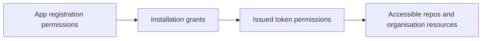
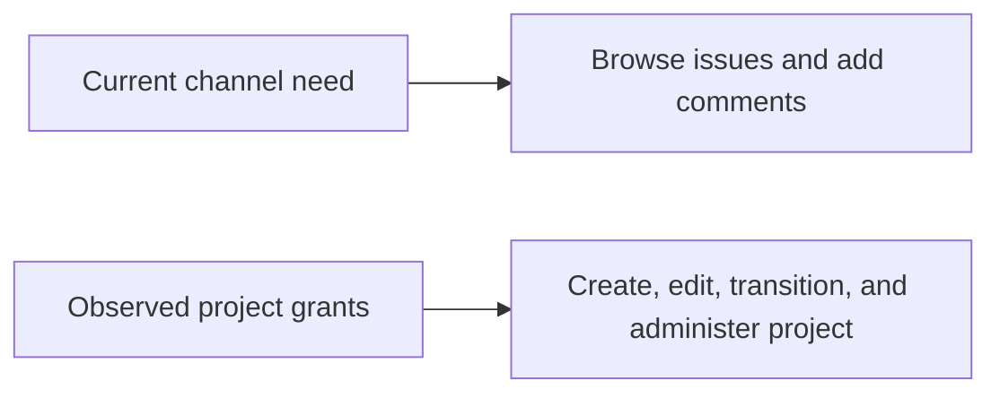

# 12 · Live integration permissions and requested access

Checked: 2026-11-06, approximately 02:32–02:38 UTC.

Status: observed permission snapshot. This document does not grant approval or change access.

## Evidence levels

- **Live:** authenticated provider or Azure configuration response.
- **Requested:** scopes or permissions selected by the reviewed code and setup.
- **Proposed minimum:** access to consider for approval. This is not a deployed restriction.
- **Unverified:** the available credentials did not expose the registration or user grant.

Short-lived GitHub installation tokens supported metadata checks. No repository, issue, project, or permission was changed.

The GitHub CLI session supported the review. Its own scopes are not the portal OAuth App's scopes.

## 1. Which integrations are configured?

| Integration | Identity or registration | What we verified | Evidence |
| --- | --- | --- | --- |
| GitHub bot App | `SlopCodeDev`, slug `slopcodedev`, App ID `5367720` | App permissions, event subscriptions, installations, issued token permissions, accessible repos | Live |
| GitHub App client | `Iv23lizLVSNdMi0sNkA8` | This belongs to the bot App. It differs from the portal client. | Live |
| GitHub OAuth App | Client ID `Ov23li2PAmP1g7qqCw8e` | Both local and deployed portal configurations use `oauth` mode and this client. | Live configuration; user grant unverified |
| Jira service account | `slopcodebot`, active, account type `app` | Identity and effective permissions for project `KAN` | Live |
| Jira OAuth app | Client ID `jUXAjQKzdQb09b7IuOJ8Z99j0WlY1O1C` | Local and deployed portal client IDs match. No deployed scope override was present. | Live configuration; consented scopes unverified |
| Entra portal app | `slop-portal-poc`, client ID `4955d8da-078e-4a2f-8bc7-d3c6085a2d77` | Single-tenant registration; `requiredResourceAccess` is empty | Live registration |

An empty Entra `requiredResourceAccess` list is registration evidence. It does not prove that every runtime access policy is enforced.

The Jira site is `https://thecloudplumbingco.atlassian.net/`.

The Jira service account ID is `712020:9a62b034-dabf-4364-b257-f4ad41e00a74`.

## 2. GitHub App: actual grants and requested use

| Permission | Actual App grant | Why the integration requests it | Current use and approval boundary |
| --- | --- | --- | --- |
| Metadata | Read | Identify repos and installations | Baseline repo access |
| Issues | Write | Read issue context; post comments and reactions | Current bot path; future issue creation also needs a task policy |
| Pull requests | Write | Read PR context and post supported replies | Current channel capability; does not establish permission to approve every task |
| Contents | Write | Dispatch research through `repository_dispatch` | Current Azure research path requires write; broader than source read access |
| Organisation Projects | Write | Support the intended Project automation | Granted on the organisation installation; this check did not establish current broker Project updates |

GitHub reports `write` for write-capable grants. These entries also permit the corresponding reads.

### Installation boundaries

| Installation | Repository selection | Repos returned | Projects grant |
| --- | --- | --- | --- |
| `TheCloudPlumbingCo`, installation `172722791` | All repositories | 11 | Organisation Projects write |
| Personal test installation, `177094049` | Selected repositories | 1 | No Organisation Projects grant |

Both installations grant Contents write, Issues write, Pull requests write, and Metadata read.

The app and token responses agree with these installation boundaries.

The personal installation does not receive the organisation Projects grant shown in the App registration.

The organisation installation returned these repos:

- `TheCloudPlumbingCo/plumbing-website`
- `TheCloudPlumbingCo/aws-plumbing`
- `TheCloudPlumbingCo/octokit.js`
- `TheCloudPlumbingCo/slop-factory-pieces`
- `TheCloudPlumbingCo/teahouse-workspace`
- `TheCloudPlumbingCo/teahouse-core`
- `TheCloudPlumbingCo/teahouse-water-service`
- `TheCloudPlumbingCo/teahouse-tealeaf-service`
- `TheCloudPlumbingCo/teahouse-tea-service`
- `TheCloudPlumbingCo/teahouse-env`
- `TheCloudPlumbingCo/teahouse-load-gen`

The selected personal repo was `yashodhah/slop-research-spike`.

**Proposed minimum:** select only approved workspace, implementation, and dispatch repos unless all-repository access has an explicit justification.

Repository selection does not itself define the organisation Project boundary. Review Project access separately.

### Live event subscriptions

`commit_comment`, `issues`, `issue_comment`, `issue_relates_to`, `pull_request`, `pull_request_review`, `pull_request_review_comment`, `pull_request_review_thread`.

These subscriptions exceed the four-event starter setup. Confirm which handlers need each event before approving the final subscription set.

## 3. Portal OAuth: requested scopes

This table lists what the code requests. It does not claim that a particular user consented to every scope.

| Integration | Requested scope | Why requested | Risk or decision |
| --- | --- | --- | --- |
| GitHub OAuth App | `repo` | List private repos and find private review requests | Broad repo access includes write capability despite read-only portal calls |
| GitHub OAuth App | `read:user` | Read the account label through `/user` | Confirm necessity; the current code only needs the login label |
| Jira OAuth app | `read:issue-details:jira` | Published granular scope set for GET enhanced issue search | Review the exact endpoint scope requirement |
| Jira OAuth app | `read:audit-log:jira` | Same published scope set | The portal does not call an audit endpoint; the grant still needs review |
| Jira OAuth app | `read:avatar:jira` | Same published scope set | No separate avatar feature is established |
| Jira OAuth app | `read:field-configuration:jira` | Same published scope set | The current request returns issue summaries |
| Jira OAuth app | `read:issue-meta:jira` | Same published scope set | Review with the other search scopes |
| Jira OAuth app | `read:me` | Read the connected user label | User identity read |
| Jira OAuth app | `offline_access` | Refresh user access without repeated consent | Requires secure refresh-token storage and revocation procedures |

The deployed portal has no `ATLASSIAN_SCOPES` override. The checked repository version therefore uses its default scope list.

Confirm the deployed image version before treating repository defaults as proof of the exact running authorisation request.

The Atlassian developer-console configuration and actual user consent grant remain unverified.

The GitHub OAuth App's actual user token grant also remains unverified.

An attempt to inspect only the current Azure CLI user's stored portal connections could not complete through container execution.

No other user's stored connection was inspected. No new user consent was initiated.

**Proposed minimum:** use GitHub App user access where possible. Retain broad OAuth access only for an approved requirement.

See the [identity review](11-identity-and-integration-risk-review.md) for provider documentation and the GitHub App alternative.

## 4. Jira service account: effective project permissions

The service account could list project `KAN`, named `TheCloudPlumbingCo`.

The following permissions came from Jira's `/mypermissions` response with `projectKey=KAN`.

| Permission | Live result | Required by current read-and-reply channel? | Approval consideration |
| --- | --- | --- | --- |
| `BROWSE_PROJECTS` | Yes | Yes | Needed to read authorised issue context |
| `ADD_COMMENTS` | Yes | Yes | Needed for acknowledgements and replies |
| `CREATE_ISSUES` | Yes | Not established | Could support later issue creation; justify separately |
| `EDIT_ISSUES` | Yes | Not established | Could support later labels or issue updates; justify separately |
| `TRANSITION_ISSUES` | Yes | Not established | Could support later workflow updates; justify separately |
| `ADMINISTER_PROJECTS` | Yes | No current requirement established | Project administration exceeds the reviewed channel need |
| `ADMINISTER` | No | No | Global Jira administration was not granted in this check |

This is a bounded permission check for KAN. It is not a complete enumeration of Jira permissions or issue-security access.

The tested token authorised identity, project discovery, and permission reads.

These successful calls do not reveal its complete API scope list or prove write operations will succeed.

Exact API-token scopes, expiry, and creation policy require Atlassian administration evidence.

**Proposed minimum:** Browse Projects and Add Comments for the present channel, with endpoint-required API scopes.

Approve issue creation, edits, and transitions separately when the corresponding workflow is implemented.

Project administration has no demonstrated requirement in the current channel.

## 5. Decisions for the approval request

| Integration | Proposed request to reviewers | Existing access to review |
| --- | --- | --- |
| GitHub bot App | Approve exact repo selection and required issue, PR, dispatch, and Project operations | All-repo installation and code write access |
| GitHub OAuth App | Approve `repo` only if a narrower GitHub App user connection is insufficient | Broad user-delegated read and write scope |
| Jira service account | Approve issue context reads and bot comments on named projects | Project administration and additional issue mutation permissions |
| Jira OAuth app | Approve the selected issue-search, user-profile, and refresh scopes on named sites | Confirm configured and consented scopes before final approval |

The approved integration scope does not replace requester checks or per-task approval.

The Jira handler still permits recognised requests without the proposed requester policy.

The GitHub mention check still establishes access only in the triggering repo.

## 6. How this snapshot was checked

| Check | Read-only evidence source |
| --- | --- |
| GitHub App registration | `GET /app` authenticated with the App JWT |
| GitHub installations | `GET /app/installations` |
| Installation token permissions | Token issuance response, inspected without storing token values |
| Accessible GitHub repos | `GET /installation/repositories` |
| Jira bot identity | `GET /rest/api/3/myself` through the Atlassian gateway |
| Jira projects | `GET /rest/api/3/project/search` |
| Jira KAN permissions | `GET /rest/api/3/mypermissions?projectKey=KAN` with the listed permission keys |
| Deployed portal mode and client IDs | Azure Container App non-secret environment configuration |
| Entra registration | Azure CLI application metadata query |
| Requested OAuth scopes | [GitHub provider](../portal-poc/lib/providers/github.ts), [Jira provider](../portal-poc/lib/providers/jira.ts) |

Secret values, private keys, access tokens, and refresh tokens are excluded from this document.

Recheck grants after app permission changes, installation changes, token replacement, or Jira role changes.
