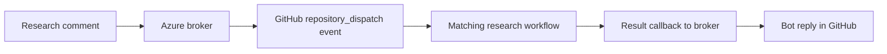
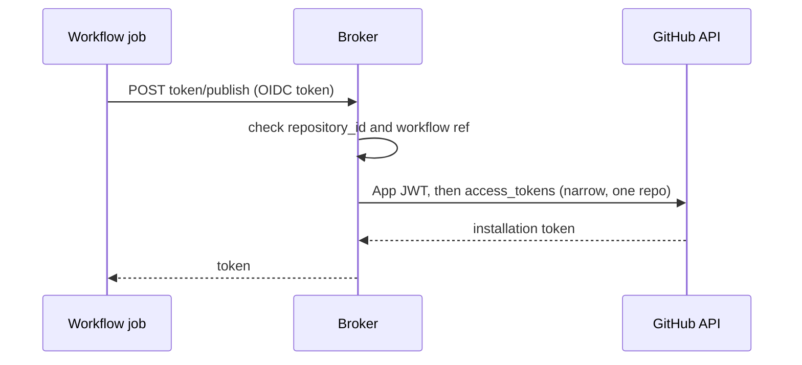
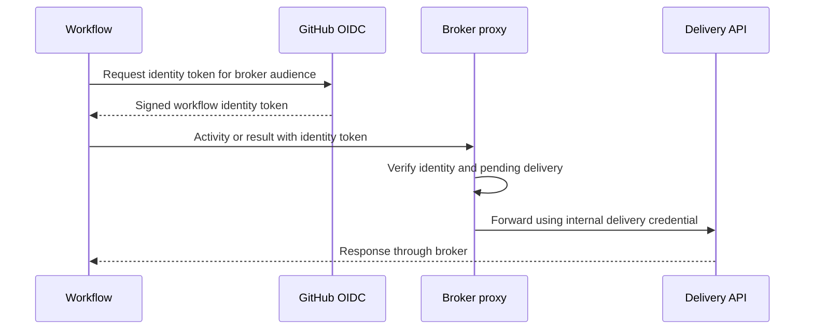

# 13 · How the broker starts research workflows

Checked: 2026-11-06.

## 1. The direct answer

The Azure broker authenticates as the GitHub App and sends a `repository_dispatch` event to the target repo.

The target repo has a workflow that listens for `slopcodebot-research`.

GitHub starts that workflow when it receives the matching event.

This uses the bot App credentials. The portal's GitHub OAuth connection does not start this workflow.



## 2. How the broker starts it

1. The GitHub mention handler checks the author's access in the triggering repo.
2. The research handler recognises `/research` and reads the issue or PR reference.
3. For a repo ending in `-workspace`, the command must include a valid `--ws` value.
4. The broker stores a pending delivery record, including its repo ID and internal delivery credential.
5. The broker signs an App JWT using `GITHUB_APP_ID` and `GITHUB_PRIVATE_KEY`.
6. It requests an installation access token from GitHub.
7. It posts the dispatch event to the repo from the issue or PR reference.

### How the workflow gets its GitHub tokens

The workflow does not hold the App private key. The key stays in the broker's Key Vault.

1. The job asks GitHub for an OIDC token. The audience is the broker origin.
2. The job calls `POST /research-session/{deliveryId}/token/read` and `.../token/publish`.
3. The broker checks the OIDC token: `repository_id` and `job_workflow_ref`, as for `complete`.
4. The broker mints an installation token. Read: `contents: read`. Publish: `pull_requests` and `issues` write, for the one repo.
5. The job uses the tokens. They expire in about one hour.



The job must ask within 15 minutes of the dispatch, while the pending record lives.

The code dispatches to the originating repo. It does not currently look up a central workflow repo for arbitrary channel requests.

The Azure research handler requires a GitHub discussion reference. Jira user OAuth is not part of this dispatch path.

### The outgoing API call

```http
POST /repos/{owner}/{repo}/dispatches
Authorization: Bearer <installation-token>
```

```json
{
  "event_type": "slopcodebot-research",
  "client_payload": {
    "task": "Find the timeout behaviour",
    "workspace": "be",
    "issueNumber": 42,
    "deliveryId": "<delivery-id>",
    "brokerOrigin": "<broker-origin>"
  }
}
```

These are example task values. The broker builds the actual payload from the request.

The payload does not contain the App private key or internal delivery credential.

GitHub returns `204` when it accepts the dispatch request. Acceptance does not prove that research completed.

## 3. Why Contents write permits dispatch

The `repository_dispatch` endpoint requires Contents write for GitHub App tokens.

The live `SlopCodeDev` installation has that grant. This explains why the broker can dispatch without an Actions write grant.

This is a repository event API. Its permission requirement differs from a `workflow_dispatch` endpoint.

Provider source: [repository dispatch API](https://docs.github.com/en/rest/repos/repos#create-a-repository-dispatch-event).

The broker's current token request does not narrow the token to the target repo or a smaller permission set.

See the [live permission snapshot](12-live-integration-permissions.md) for the installation grants.

## 4. How GitHub selects the workflow

The checked workspace workflow contains this trigger:

```yaml
on:
  repository_dispatch:
    types: [slopcodebot-research]
```

The event name matches the broker's `RESEARCH_EVENT_TYPE` constant.

The broker does not name `research.yml` in its API call. GitHub selects workflows with a matching trigger.

The workflow must exist on the default branch for this event to start it.

Task fields become available through `github.event.client_payload`.

Provider source: [repository dispatch workflow trigger](https://docs.github.com/en/actions/reference/workflows-and-actions/events-that-trigger-workflows#repository_dispatch).

Live workspace source: [research.yml](https://github.com/TheCloudPlumbingCo/teahouse-workspace/blob/main/.github/workflows/research.yml).

## 5. Starting a workflow and running its steps use different access

| Operation | Credential or configuration | Why it is separate |
| --- | --- | --- |
| Broker sends dispatch | App installation token | Authorises the broker's GitHub API call |
| Runner checks out and pushes workspace files | Workflow `GITHUB_TOKEN` with Contents write | Applies inside the started job |
| Runner requests a callback identity token | Workflow `id-token: write` | Permits obtaining a GitHub Actions OIDC identity token |
| Runner requests Project access | App ID and private key through the token action | Separate installation-token request for board operations |
| Runner requests cross-repo reads | App ID and private key through the token action | Workflow requests Contents read for cloning workspace repos |
| Runner runs Copilot | Repository secret `COPILOT_GITHUB_TOKEN` | Separate agent authentication |
| Runner opens the research PR | App token requested with Pull requests write | Workflow comment records a restriction on PR creation with the default token |

The workflow declares Contents write, Pull requests write, and `id-token: write`.

Those YAML permissions do not grant the broker permission to dispatch. They configure access for the workflow execution.


The workspace repo needs the secret `COPILOT_GITHUB_TOKEN`. It holds no App private key. The broker makes the workflow's GitHub tokens.

Only their names were inspected. Their values and credential validity were not inspected.

The table describes token requests in the YAML. Exact runner-issued token grants were not inspected.

### Permission boundary to review

The workflow requests a clone token without a repo list. It then clones the repos named by the workspace configuration.

A configured clone list is not itself a token restriction.

The runner also receives the App private key through repository secrets.

Narrower issued tokens do not limit what someone controlling that private key could request later.

Review workflow modification rights, secret access, installation selection, and App credential custody together.

## 6. How the result returns



The current workspace workflow calls `/research-session/{deliveryId}/activity`, `/skills`, `/complete`, or `/fail`.

The broker checks token signature, issuer, audience, expiry, repo identity, allowed workflow reference, and pending delivery.

The broker retains the internal delivery credential. It uses that credential behind the proxy rather than giving it to the runner.

Pending records last 15 minutes in the reviewed source. Successful completion or failure removes the pending record.

An accepted callback does not by itself establish that the research is correct or approved.

### Deployment consistency check

The reviewed local proxy requires `job_workflow_ref`. GitHub documents that claim for reusable workflow jobs.

The checked workspace YAML defines an inline job. Recent successful runs therefore do not establish that the deployed proxy matches local source.

Confirm the deployed handler and actual callback claims before treating the local trust check as deployment evidence.

Provider source: [GitHub OIDC claims](https://docs.github.com/en/actions/reference/security/oidc).

## 7. Observed runs and the older test workflow

The two latest inspected workspace runs completed successfully:

- [Run 41787199404](https://github.com/TheCloudPlumbingCo/teahouse-workspace/actions/runs/41787199404), 2026-11-04, `repository_dispatch`.
- [Run 41784590084](https://github.com/TheCloudPlumbingCo/teahouse-workspace/actions/runs/41784590084), 2026-11-04, `repository_dispatch`.

These are run-history observations. No new workflow was started for this explanation.

The older personal test workflow expects `client_payload.accessToken` and calls `/deliveries` directly.

The current broker payload omits that field and uses the OIDC proxy model.

Do not assume the older test workflow is compatible with the current broker.

Older source: [research-broker.yml](https://github.com/yashodhah/slop-research-spike/blob/main/.github/workflows/research-broker.yml).

## 8. Local source references

- [Production wiring](../infra/azure/src/Production.ts)
- [Research command and payload](../infra/azure/src/ResearchAgentSessions.ts)
- [App JWT, installation token, and dispatch call](../infra/azure/src/GithubDispatch.ts)
- [Pending delivery storage](../infra/azure/src/PendingResearch.ts)
- [Callback identity checks](../infra/azure/src/OidcProxy.ts)
- [GitHub requester check](../packages/core/src/channels/GithubMention.ts)
