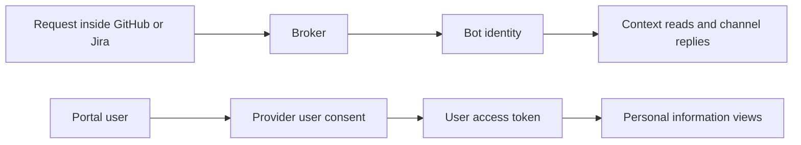
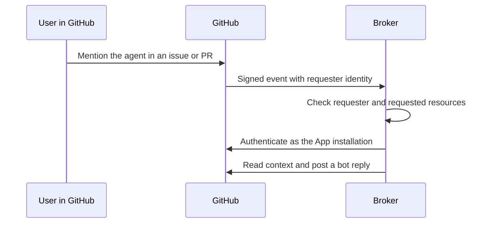
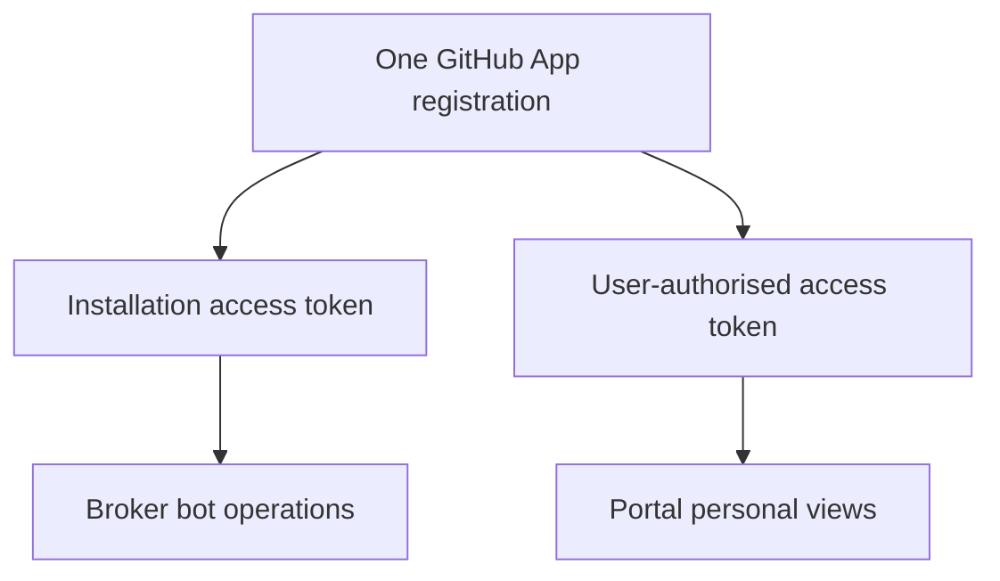
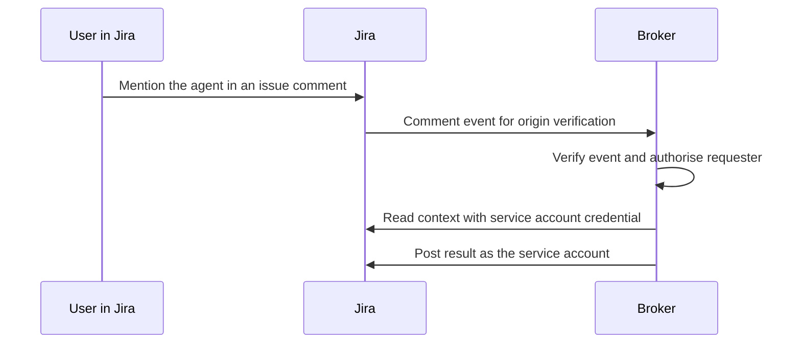
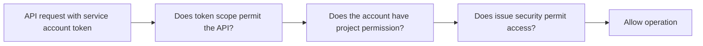
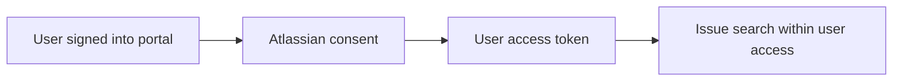
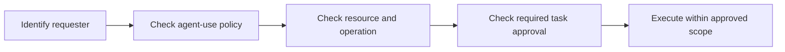

# Agent Workflow Automation: Identity, Access and Integration Architecture

## 1. Purpose of this request

Request approval for the identities and permissions needed for agent invocation through GitHub, Jira, and a supplementary portal.

Each identity section explains where we use it, why we need it, how access works, and which permissions we request.

This is an access request, not an inventory of deployed permissions.

The requested boundaries require implementation and validation before approved use.

| Item | Position |
| --- | --- |
| Audience | Information Risk Assessment, identity owners, and integration owners |
| Decision requested | Approve the stated identity types, purposes, resource boundaries, and permission sets |
| Approval status | Pending |
| Resource selection | Named repositories, Jira projects, and sites require owner approval during onboarding |
| Submission content | This request and the [channel and portal explanation](15-channel-invocation-and-portal-access.md) |

## 2. Channel invocation and portal access

**Channel-based invocation:** a person requests agent work inside a GitHub or Jira discussion.

**Portal access:** a person uses the web application to connect accounts, find work, and see their accessible information.

The broker receives channel requests and coordinates agent work. Bot identities allow it to read context and return replies.

Portal user connections allow the web application to read information using the signed-in person's access.

For examples, read [Channel-Based Invocation and Portal Access](15-channel-invocation-and-portal-access.md).

## 3. Approval summary

| Identity | Used for | Why needed | Permission request |
| --- | --- | --- | --- |
| GitHub App installation identity | GitHub channel invocation and bot actions | Stable automation identity with selected repository access | Metadata read; Issues write; Pull requests write |
| Same GitHub App acting for a user | GitHub portal connection | Personal views without a separate broad OAuth App | User authorisation under the App's grants and the user's access |
| GitHub App workflow permissions | Research execution and coordination | Start workflows and perform approved repository or Project operations | Contents and organisation Projects permissions for enabled functions only |
| Jira service account | Jira channel invocation and bot replies | Stable non-human author with controlled project permissions | Browse Projects and Add Comments; corresponding API-token scopes |
| Atlassian OAuth 2.0 3LO app | Jira portal connection | Read Jira using each consenting user's permissions | `read:jira-work`, `read:me`, and `offline_access` |
| Entra application and user identity | Portal sign-in | Establish the organisation user before account connection | OIDC sign-in: `openid`, `profile`, and `email` |

A separate GitHub OAuth App is not part of the default request.

The GitHub App supports both bot access and user-authorised portal access.

## 4. GitHub App identity

### 4.1 Where we use it

Use the GitHub App for channel-based invocation from issues and pull requests.

The broker receives relevant events, checks the requester, reads context, and returns progress or results.

The same App can support the portal through user authorisation.

### 4.2 Why we need it

A GitHub App provides a non-human identity for automation.

Installation owners select its repositories. App permissions define its allowed API operations.

This provides stable bot attribution without using an employee's personal credential for background replies.

### 4.3 How channel access works

The installation token represents the App. It does not automatically inherit the requester's permissions.

The broker must check the requester before using the App's access on their behalf.

### 4.4 Permissions requested for channel invocation

| Permission | Level | Why needed |
| --- | --- | --- |
| Repository Metadata | Read | Identify selected repositories and their metadata |
| Repository Issues | Write | Read issue context; post acknowledgements, comments, and supported reactions |
| Repository Pull requests | Write | Read PR context and respond to supported PR discussions |

GitHub reports `write` for write-capable grants. Those grants also permit the corresponding reads.

These permissions permit more than individual reply operations. Application policy must restrict their use to approved functions.

Select only the webhook events needed to recognise supported requests and discussion changes.

Initial events cover issues, issue comments, pull requests, and pull request review comments.

### 4.5 Additional permissions for enabled workflow functions

| Function | Permission | Level | Why needed |
| --- | --- | --- | --- |
| Research source files | Repository Contents | Read | Read code in approved repositories |
| Start workflows through `repository_dispatch` | Repository Contents | Write | GitHub requires this level for that dispatch API |
| Publish research files or implementation branches | Repository Contents | Write | Push approved work to approved repositories |
| Create research or implementation PRs | Repository Pull requests | Write | Submit work for review |
| Update organisation-owned Project views | Organisation Projects | Write | Reflect task progress in GitHub Projects |

Request these additional permissions only when the corresponding function is enabled.

Contents write grants broader capability than source reads. Approve that capability explicitly when workflow dispatch is required.

Read-only source access does not satisfy the `repository_dispatch` requirement.

Organisation Project access needs a separate approved resource boundary.

Starting a workflow and granting access to its runner are separate decisions.

Runner credentials and model-service access require approval for their own operations.

### 4.6 Using the same GitHub App in the portal

The user signs into the portal, then authorises the GitHub App to act on their behalf.

The portal obtains a GitHub App user access token for that connection.

The installation token and user token serve different roles. They must not be exchanged or treated as equivalent credentials.

Private-resource access through the user token depends on both the App's grants and the user's permissions.

The portal uses it for personal repository and review-request views.

A separate GitHub OAuth App is unnecessary for this design.

### 4.7 Shared registration boundary

Sharing the registration does not make the portal token read-only.

If both the App and user have write permission, the user token can also permit writes.

The requested portal functions are reads. Server-side routes and credential handling must enforce that operating scope.

If policy requires a credential-level read-only portal boundary, use a separate App with read-only grants.

That separation is a policy option, not a requirement for supporting both interaction paths.

### 4.8 Approval conditions

- Install the App only on owner-approved repositories.
- Approve each enabled workflow and Project function.
- Check requester access for each target repository and operation.
- Narrow installation tokens by repository and permission where supported.
- Keep App private keys under controlled custody.
- Review runners that can obtain an App key or mint installation tokens.
- Keep technical permission grants separate from task approval.

Sources: [GitHub App permissions](https://docs.github.com/en/apps/creating-github-apps/registering-a-github-app/choosing-permissions-for-a-github-app), [App user access](https://docs.github.com/en/apps/creating-github-apps/authenticating-with-a-github-app/generating-a-user-access-token-for-a-github-app), [dispatch API](https://docs.github.com/en/rest/repos/repos#create-a-repository-dispatch-event).

## 5. Jira service account identity

Jira Cloud now calls its issue containers spaces. This section retains project terminology for technical permission names.

Approved projects means approved Jira spaces. See the [terminology explanation](15-channel-invocation-and-portal-access.md#7-jira-project-and-jira-space-mean-the-same-container).

### 5.1 Where we use it

Use the Jira service account for channel-based invocation from Jira issues and comments.

The broker reads permitted issue context and posts acknowledgements or results as the bot.

### 5.2 Why we need it

The channel needs a stable non-human author for background replies.

A dedicated service account separates bot activity from an employee's personal Jira account.

Project permissions define where it may read and reply.

### 5.3 How channel access works

Use a scoped service account credential held by the integration backend.

That credential represents the service account. It does not represent the person who wrote the comment.

The broker must check the requester separately and preserve the issue's disclosure boundary.

### 5.4 Jira project permissions requested

Project permissions belong to the service account, through Jira permission schemes or project access settings.

They answer: what may this account do in this specific project?

Ask the Jira administrator to apply the following permissions only to the approved projects.

| Permission | Why needed | Boundary |
| --- | --- | --- |
| Browse Projects | Read the issue and relevant context | Approved projects and permitted issue-security levels |
| Add Comments | Post acknowledgements and results | Issues within those approved projects |

Issue-level security can further restrict access. Configure it consistently with the approved use case.

Project administration and global administration are not requested.

Issue creation, editing, deletion, and workflow transitions need separate approval if those functions are introduced.

### 5.5 API-token scopes requested

Token scopes belong to the API credential issued for the service account.

They answer: which Jira API operations may this credential request?

Ask the service account administrator to issue a scoped API token with the following classic scopes.

| Scope | Purpose |
| --- | --- |
| `read:jira-work` | Read issue context needed for the request |
| `write:jira-work` | Use the Jira comment-write API |

Scopes do not select project names. Granting a scope does not add project permissions to the account.

The classic write scope covers more API operations than comment creation.

Restrict the service account's project permissions to Browse Projects and Add Comments for the stated channel use.

Do not grant issue mutation or administration rights merely because the API scope includes those capabilities.

If policy requires narrower token scopes, select the endpoint-specific granular set instead and submit it for approval.

The approved scope set must match the issued credential before release.

### 5.6 How Jira combines the two settings

Both scope and project permission must allow the operation. Issue security and other applicable controls can further restrict access.

| Requested operation | Token scope | Project permission | Result at these two permission layers |
| --- | --- | --- | --- |
| Read an issue | `read:jira-work` | Browse Projects | Permitted, subject to issue security |
| Add a reply | `write:jira-work` | Browse Projects and Add Comments | Permitted, subject to issue security |
| Edit an issue | `write:jira-work` | Edit Issues not granted | Blocked despite the broad write scope |
| Read another project | `read:jira-work` | Browse Projects not granted there | Blocked despite the read scope |

Check effective permissions across all account groups and roles. A broad membership can add unintended project access.

### 5.7 Exact provisioning request

Use this text in the onboarding request. Replace the project placeholder before submission.

> Create a dedicated Jira service account for the agent broker.
>
> Grant Jira product access as required for its approved operation.
>
> Limit project access to: `<approved project keys>`.
>
> Grant Browse Projects and Add Comments in those projects, with only the required issue-security access.
>
> Do not grant issue creation, editing, deletion, transitions, or project/global administration for this use case.
>
> Issue a scoped service account API token with `read:jira-work` and `write:jira-work`.
>
> Record the account owner, token owner, expiry date, rotation process, and secure backend delivery method.
>
> The token will support issue-context reads and bot comments only.

The classic token scope is broader than this operating purpose. The restricted project role is therefore part of the request.

If the token must independently exclude other write APIs, request a granular scope design before issuing the credential.

### 5.8 Approval conditions

- Create a dedicated service account with a named owner.
- Restrict it to approved sites, projects, and issue-security levels.
- Apply the stated project permissions and selected API scopes together.
- Keep credentials server-side and define expiry, rotation, and revocation.
- Authorise the requester before reading or acting through the bot identity.
- Return findings only to an audience authorised to receive their source information.

Sources: [service account tokens](https://support.atlassian.com/user-management/docs/manage-api-tokens-for-service-accounts/), [comment API permissions](https://developer.atlassian.com/cloud/jira/platform/rest/v3/api-group-issue-comments/#api-rest-api-3-issue-issueidorkey-comment-post).

## 6. Atlassian OAuth 2.0 3LO app

### 6.1 Where we use it

Use the Atlassian OAuth app for a person's Jira connection in the portal.

The portal searches issues and shows information available to that person.

### 6.2 Why we need it

The portal needs personal access rather than the service account's bot access.

Using the bot credential for personal search could expose information outside the user's permissions.

The 3LO flow obtains explicit user consent and an access token for that user.

Three-legged OAuth means that the user, portal application, and Atlassian participate in authorisation.

### 6.3 How portal access works

The portal validates the authorisation response and stores the resulting tokens securely.

API access remains subject to the granted scopes and the user's Jira permissions.

The client secret identifies the integration during token exchange. It does not replace user consent.

### 6.4 Scopes requested

The proposed approval set uses classic scopes for Jira issue search.

| Scope | Why needed | Access requested |
| --- | --- | --- |
| `read:jira-work` | Search issues and read relevant issue information | User-delegated Jira reads |
| `read:me` | Identify and display the connected Atlassian account | User profile read |
| `offline_access` | Refresh access without repeated interactive consent | Refresh-token capability |

These are requested design scopes. Application configuration must match the approved set before release.

`read:jira-work` can permit more issue-related reads than the search screen displays.

Restrict portal endpoints to approved uses and allow access only to approved Jira sites.

Write scopes, Jira administration, and Jira project management are not requested for the portal.

If granular scopes replace the classic read scope, review their exact endpoint requirements as an alternative set.

Do not request both sets merely to avoid deciding the required scope.

### 6.5 Approval conditions

- Register the integration under an accountable application owner.
- Approve the scope set and allowed Jira sites.
- Require each user to complete provider consent.
- Keep client secrets, access tokens, and refresh tokens server-side.
- Handle refresh-token rotation and upstream revocation.
- Keep the personal user connection separate from the Jira bot credential.

Sources: [Atlassian user OAuth](https://developer.atlassian.com/cloud/jira/platform/oauth-2-3lo-apps/), [Jira scope definitions](https://developer.atlassian.com/cloud/jira/platform/scopes-for-oauth-2-3LO-and-forge-apps/).

## 7. Organisation sign-in identity

### 7.1 Where and why we use it

Use Entra to authenticate people entering the portal.

This establishes an organisation identity before they connect GitHub or Jira accounts.

It does not grant repository or Jira project access.

### 7.2 Access requested

| OIDC scope | Purpose |
| --- | --- |
| `openid` | Establish the authenticated user identity |
| `profile` | Obtain basic profile claims for the portal |
| `email` | Display an email claim when the provider supplies one |

Directory-wide read or write access is not requested by this sign-in requirement.

An additional group-membership API integration would require a separate permission decision.

### 7.3 Approval conditions

Restrict sign-in to the approved tenant and permitted users.

Use stable tenant and object IDs for identity linkage. Do not authorise by display name or email matching.

Define the application policy that determines who may invoke agents.

Provider consent and successful sign-in do not replace that policy.

Source: [Microsoft OIDC sign-in](https://learn.microsoft.com/en-us/entra/identity-platform/v2-protocols-oidc).

## 8. Common approval boundaries

### 8.1 Resource boundary

The onboarding approval must name the allowed repositories, Jira sites, Jira projects, and GitHub Projects.

This document requests selected resources. It does not request unrestricted organisation or tenant access.

### 8.2 Requester and task boundary

An integration grant permits technical operations. A task approval authorises a particular use of those operations.

Workspace plan approval does not replace code review in target repositories.

### 8.3 Credential boundary

Installation tokens, user tokens, service account credentials, and workflow identity tokens must retain distinct roles.

Keep credentials outside browser-visible data and source-control history.

Define credential owners, storage controls, expiry, refresh, rotation, revocation, and offboarding.

### 8.4 Information boundary

Read only the context needed for the approved task.

Keep results within an authorised audience when source repos and destination issues have different access rules.

Agent-runtime and model-provider processing require their own assessment. Provider integration approval alone does not authorise that processing.

## 9. Decisions requested from IRA and resource owners

| Decision | Requested outcome |
| --- | --- |
| GitHub App model | Approve installation identity for channel operations and user-authorised access for the portal |
| GitHub base permissions | Approve Metadata read, Issues write, and Pull requests write on selected repos |
| GitHub workflow functions | Approve only the enabled Contents and organisation Projects operations in section 4.5 |
| Shared GitHub App | Accept the shared grant boundary, or require separate portal and automation registrations |
| Jira channel identity | Approve a dedicated service account with Browse Projects and Add Comments |
| Jira service account scopes | Approve classic read/write scopes with project restrictions, or an agreed granular alternative |
| Jira portal identity | Approve 3LO with `read:jira-work`, `read:me`, and `offline_access` |
| Entra sign-in | Approve organisation sign-in and the permitted-user policy |
| Operational controls | Approve credential custody, audit requirements, and revocation procedures |

Record owners, selected resources, conditions, and review dates in the onboarding approval.

Approval of this design does not establish that all required controls are already implemented.
