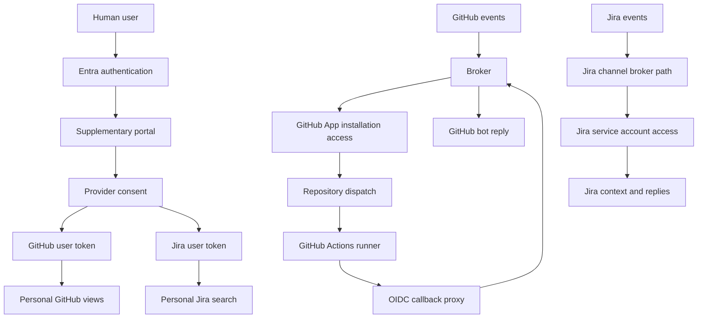
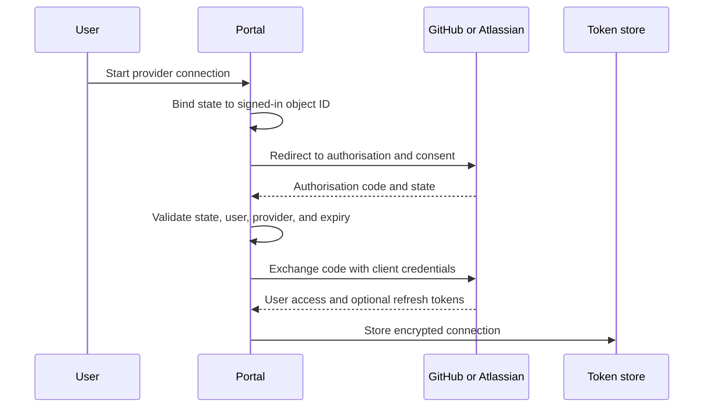
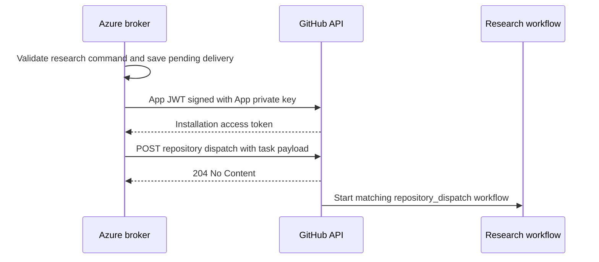
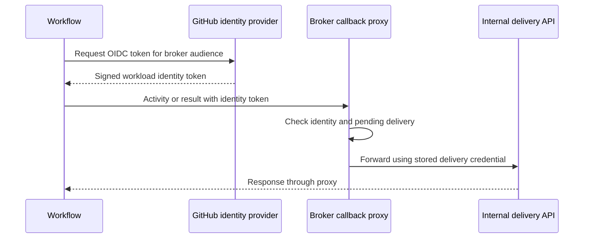
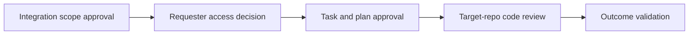

# Agent Workflow Automation: Identity, Access and Integration Architecture

GitHub and Jira integrations, credential flows, permissions, trust boundaries, and approval requirements.

## 1. Document control

| Field | Value |
| --- | --- |
| Document version | 1.0 |
| Date | 2026-11-06 |
| Status | Draft for Information Risk Assessment |
| Intended audience | Information Risk, Identity, Platform, GitHub, Jira, and application owners |
| Application | Agent workflow automation and supplementary portal |
| Document owner | To be assigned |
| Information classification | To be assigned by the information owner |
| Approval status | Pending; no approval is implied by this document |
| Evidence date | Repository review and authenticated checks performed on 2026-11-06 |

### 1.1 Evidence terminology

| Term | Meaning |
| --- | --- |
| Observed | An authenticated API response or live configuration confirmed the stated condition |
| Implemented | Reviewed repository code contains the behaviour; deployed parity might remain unverified |
| Requested | Code or workflow configuration asks for the stated access |
| Proposed | A design requirement or recommended control that needs a decision or implementation |
| Unverified | Available evidence does not establish the condition |

Observed registration permissions, installation grants, issued token permissions, and user consent are different evidence categories.

This document preserves those distinctions. It does not treat a configured permission request as proof of user consent.

## 2. Executive summary

The platform connects user requests to agents that research and implement changes across repositories.

GitHub holds the shared issues, research, plans, code changes, reviews, and Project views.

The broker receives provider events, checks requests, starts work, and returns results to the originating discussion.

The portal provides account connections and supplementary user views. It does not replace GitHub task or approval records.

Four separate decisions govern access:

1. Establish the human identity.
2. Decide whether that person may use the agent.
3. Check the requested resources and operations.
4. Check approval for the specific task and plan revision.

Entra sign-in addresses the first decision. Provider grants and application policy address the remaining decisions together.

The current implementation does not enforce the complete proposed authorisation model.

### 2.1 Principal findings

| Area | Confirmed position | Assessment implication |
| --- | --- | --- |
| GitHub bot App | Contents, Issues, Pull requests, and organisation Projects write are granted | Review operation scope and credential custody |
| GitHub organisation installation | All-repository selection; 11 repos returned | Approve or reduce the repository boundary |
| Portal GitHub integration | Deployed OAuth mode; code requests `repo` and `read:user` | Broad delegated access needs justification |
| Jira bot | KAN permissions include project administration and issue mutation | Existing access exceeds the demonstrated read-and-reply need |
| Jira user integration | Client configuration confirmed; requested scopes identified | Actual consent grants remain unverified |
| Central agent-use policy | Not enforced in reviewed channel paths | Entra sign-in alone is insufficient |
| Credential lifecycle | Local encrypted token storage; disconnect does not revoke provider grants | Durable storage and revocation need an approved design |
| Research workflow | Recent dispatch runs succeeded; runner uses additional credentials | Include runner access in the assessment boundary |

## 3. Purpose, scope, and limitations

### 3.1 Purpose

Provide the technical basis for reviewing identities, integration access, data movement, and task authorisation.

Provide a clear record of why each identity exists and how the components use its credentials.

### 3.2 In scope

- Entra user authentication and portal application identity.
- GitHub App installation access for broker operations.
- GitHub App user access as a supported portal alternative.
- GitHub OAuth App access in the deployed portal configuration.
- Jira service account access for the channel bot.
- Atlassian user OAuth access for portal issue search.
- Broker dispatch to GitHub Actions research workflows.
- Runner credentials, research PR creation, and OIDC result callbacks.
- Credential storage, token refresh, revocation, audit requirements, and approval boundaries.

### 3.3 Evidence limitations

The review inspected repository code, provider documentation, selected live configuration, and authenticated metadata responses.

It did not change integration grants, issue permissions, repository configuration, or Project state.

Short-lived installation tokens supported read-only metadata checks. Secret values are excluded from this document.

The review did not establish actual GitHub or Atlassian user consent grants.

It did not inspect runner-issued token grants, model-provider contracts, or the deployed broker executable.

Successful workflow history does not prove that every reviewed local control matches the deployed implementation.

The GitHub CLI identity supported inspection. Its scopes do not represent the portal OAuth App's scopes.

## 4. Design rationale

### 4.1 User needs

Users need to understand problems across repos, inspect evidence, approve scope, and track implementation.

They also need local code ownership and a final check of the combined outcome.

### 4.2 Why use a workspace repo?

A task can span several repo boundaries. The workspace holds shared configuration, research, and plans for that task.

Versioned files identify the exact configuration and plan considered during review.

A workspace parent issue links the shared outcome to implementation issues in the affected repos.

### 4.3 Why keep implementation in target repos?

Each target repo retains code ownership, checks, review rules, and change history.

Workspace plan approval does not replace target-repo code review.

### 4.4 Why keep the portal supplementary?

GitHub Projects already shows issue progress and relationships. Broker automation can update those shared records.

A second independent task database would introduce conflicting progress and approval state.

Portal features should address demonstrated needs, such as account connections or focused run controls.

### 4.5 Why separate user and bot identities?

User credentials provide a personal access view. Bot credentials provide stable automation identity and operational continuity.

Bot grants can exceed a requester's access. The broker must enforce requester limits before using those grants.

Background: [workflow and portal rationale](10-workflow-and-portal-rationale.md).

## 5. System architecture

The diagram shows related integration paths. It does not imply that every channel runs in the same deployment.

The reviewed Jira service account path is configured in the Cloudflare integration.

The reviewed workflow dispatch and callback implementation is in the Azure broker.

No implemented bridge connects arbitrary Jira requests directly to this Azure research dispatch path.

## 6. Identity and registration inventory

| Identity | Technical identifier or configuration | Purpose | Evidence |
| --- | --- | --- | --- |
| Human Entra user | Tenant ID and object ID | Identify the organisation user | Implemented sign-in |
| Entra portal registration | `4955d8da-078e-4a2f-8bc7-d3c6085a2d77` | Establish the portal sign-in application | Observed; single tenant |
| Portal managed identity | Azure user-assigned identity | Authenticate the portal to Entra without a production Entra client secret | Implemented infrastructure and authentication code |
| GitHub bot App | `SlopCodeDev`, App ID `5367720` | Receive events and perform bot operations | Observed registration and installations |
| Bot App OAuth client | `Iv23lizLVSNdMi0sNkA8` | Identify the GitHub App's OAuth client | Observed; differs from deployed portal client |
| Portal GitHub OAuth App | `Ov23li2PAmP1g7qqCw8e` | Personal repository and review-request reads | Observed deployed configuration |
| Portal GitHub App user mode | `GITHUB_AUTH_MODE=app` | Alternative personal access through GitHub App grants | Implemented; deployed mode is `oauth` |
| Jira service account | `slopcodebot` | Read context and post bot comments | Observed active account, type `app` |
| Atlassian OAuth app | `jUXAjQKzdQb09b7IuOJ8Z99j0WlY1O1C` | Jira reads using the consenting user's access | Observed deployed client; consent unverified |
| GitHub Actions workload | Workflow identity claims | Authenticate result callbacks | Implemented proxy and checked workflow configuration |
| Copilot execution credential | `COPILOT_GITHUB_TOKEN` repository secret | Authenticate the research agent | Secret name observed; value and grant unverified |

The Entra tenant is `ed3ee2cc-2cef-44c8-91c3-5aa59df65d5d`.

The Jira site is `https://thecloudplumbingco.atlassian.net/`.

The Jira account ID is `712020:9a62b034-dabf-4364-b257-f4ad41e00a74`.

Client IDs and account IDs identify registrations. They are not substitutes for secret credentials.

## 7. Authentication and integration flows

### 7.1 Entra sign-in

1. The user starts Microsoft sign-in.
2. Entra authenticates the user through the configured application.
3. Auth.js completes the authorisation response and creates the portal session.
4. The session exposes `oid` and `tid` from the identity claims.
5. Provider connections currently use `oid` as the storage key.

An Entra identity token does not authorise GitHub or Jira API calls.

The live registration has `signInAudience=AzureADMyOrg`. Its `requiredResourceAccess` list was empty during inspection.

These observations do not establish group enforcement, MFA policy, or per-task authorisation.

The Azure portal workload uses a managed identity assertion through a federated credential.

Local development supports an Entra client secret. Provider client secrets remain separate from the managed identity.

### 7.2 Provider account connection

The pending state cookie expires after ten minutes. It is encrypted and HTTP-only.

The current GitHub App mode sends a PKCE challenge and verifier.

The current GitHub OAuth App and Atlassian flows do not send PKCE parameters.

This connection proves control of the two sessions during authorisation. It does not establish an employment or access-policy decision.

### 7.3 GitHub personal access

The deployed portal uses `GITHUB_AUTH_MODE=oauth`.

It requests `repo` and `read:user`, then reads repositories and review requests through the user's token.

The code also supports GitHub App user access. That mode restricts access through both the user and app grants.

Only one portal GitHub mode operates in a deployment at a time.

Switching modes requires matching client credentials and user reconnection.

GitHub App user access does not require a separate OAuth App registration merely to use the OAuth protocol.

### 7.4 Jira personal access

The Atlassian OAuth app obtains user-delegated access through an interactive authorisation code flow.

The portal reads accessible sites, profile information, and issue search results.

User Jira permissions still apply alongside the granted OAuth scopes.

The code currently chooses the first accessible site. An approved deployment should define its intended site boundary.

The deployed environment had no `ATLASSIAN_SCOPES` override. Repository defaults identify the expected scope request.

Deployed image parity and actual user consent still require confirmation.

### 7.5 GitHub channel request

The broker receives a GitHub event containing the actor, discussion reference, and installation context.

The channel validates the event origin separately from requester authorisation.

The mention handler requires `write` access or higher in the triggering repo.

That check does not establish the requester's authority over every repo in a workspace.

The broker uses GitHub App installation access for outgoing bot operations.

Installation access is independent of the requester's personal token.

### 7.6 Broker-to-GitHub Actions dispatch

The dispatch event type is `slopcodebot-research`.

The broker sends the event to the repo identified by the originating GitHub discussion.

For a repo ending in `-workspace`, the command must include a valid `--ws` value.

The API call is `POST /repos/{owner}/{repo}/dispatches`.

For GitHub App tokens, that endpoint requires Contents write. An Actions write grant is not the dispatch requirement.

The payload contains task text, optional workspace, issue number, delivery ID, and broker origin.

It excludes the App private key, installation token, and internal delivery credential.

GitHub selects workflows with a matching event trigger. The broker does not send a workflow filename.

The matching workflow must exist on the default branch.

The current installation-token request does not narrow the repository selection or permission set.

Dispatch acceptance does not prove that a matching job started or completed.

Provider references: [dispatch API](https://docs.github.com/en/rest/repos/repos#create-a-repository-dispatch-event), [workflow trigger](https://docs.github.com/en/actions/reference/workflows-and-actions/events-that-trigger-workflows#repository_dispatch).

### 7.7 Runner credentials and research output

The workspace workflow declares Contents write, Pull requests write, and `id-token: write`.

Those declarations configure runner access. They do not authorise the broker's dispatch call.

| Runner operation | Credential used or requested |
| --- | --- |
| Checkout and push workspace files | Workflow `GITHUB_TOKEN` |
| Read participating repos | App token requested with Contents read |
| Update Project state | App token requested with organisation Projects write |
| Open research PR | App token requested with Pull requests write |
| Execute Copilot research | `COPILOT_GITHUB_TOKEN` secret |
| Authenticate broker callbacks | GitHub Actions OIDC identity token |

The workflow's `APP_ID` variable was `5367720`, matching `SlopCodeDev`.

Secret names `APP_PRIVATE_KEY` and `COPILOT_GITHUB_TOKEN` were present. Their values were not inspected.

The clone step reads repository names from workspace configuration. Its token request does not provide a repo list.

A clone list is not a credential restriction.

Runner possession of the App private key also permits additional token requests within the App's authority.

Individual narrow token requests do not restrict that underlying private key.

The agent produces research output. The workflow writes a research file and opens a workspace PR.

Research described as read-only still results in a workflow-authored branch and PR.

### 7.8 OIDC callback to the broker

Supported callback actions are `activity`, `skills`, `complete`, and `fail` under `/research-session/{deliveryId}`.

The local proxy checks signature, issuer, audience, expiry, repository ID, allowed workflow reference, and pending delivery.

The internal delivery credential remains in the broker. The runner authenticates to the proxy with its OIDC token.

The reviewed pending record expires after 15 minutes. Successful completion or failure removes it.

The current workspace workflow has a 20-minute job timeout. Align these time limits before relying on late callbacks.

The local proxy requires `job_workflow_ref`. GitHub documents that claim for reusable workflow jobs.

The inspected workspace YAML contains an inline job. Deployed handler parity and actual token claims remain unverified.

Recent successful runs do not resolve that local-source consistency question.

Provider reference: [GitHub OIDC claims](https://docs.github.com/en/actions/reference/security/oidc).

### 7.9 Jira channel bot

The Cloudflare Jira channel uses the service account API token through the Atlassian API gateway.

The channel reads issue context and posts acknowledgements or results as `slopcodebot`.

The Jira webhook secret verifies event origin. The service account token authorises Jira API operations.

The bot account ID prevents its own comments from starting another request.

`authorizeJiraMention` currently returns `true`.

A recognised request reaching that handler therefore lacks the proposed central requester policy.

The bot's project access does not automatically match the comment author's issue-security access.

## 8. Permission baseline and approval scope

### 8.1 GitHub App grants

| Permission | Observed grant | Required or intended use | Assessment requirement |
| --- | --- | --- | --- |
| Metadata | Read | Identify repositories | Confirm approved repo boundary |
| Issues | Write | Read context and post comments or reactions | Separate current replies from later issue mutations |
| Pull requests | Write | PR context and replies; runner research PR creation | Review broker and runner uses separately |
| Contents | Write | Repository dispatch; runner writes use separate credentials | Approve broad code capability explicitly |
| Organisation Projects | Write | Intended Project automation; runner board step | Review organisation Project boundary |

The organisation installation, `172722791`, selects all repos. The check returned 11 repos.

The personal test installation, `177094049`, selects one repo. It has no organisation Projects grant.

The [live snapshot](12-live-integration-permissions.md) lists all returned repos and event subscriptions.

Proposed baseline: select named workspace, implementation, and dispatch repos unless broader access receives explicit approval.

Project access requires a separate boundary decision. Repository selection alone does not define it.

### 8.2 GitHub OAuth App scope request

| Scope | Reason requested | Risk consideration |
| --- | --- | --- |
| `repo` | Private repo listing and private review-request search | Includes write capability despite current read-only portal operations |
| `read:user` | Connected account display label | Necessity for the current login label remains unproven |

The actual user grant was not retrieved. The table records the code's scope request.

Proposed baseline: use GitHub App user access when it meets the requirement.

If OAuth mode remains necessary, record the requirement and obtain approval for the broader scope.

Do not claim OAuth App tokens never expire. Verify the registration configuration and issued token metadata.

### 8.3 Atlassian OAuth scope request

| Scope | Reason requested |
| --- | --- |
| `read:issue-details:jira` | Published granular scope set for GET enhanced issue search |
| `read:audit-log:jira` | Part of that endpoint's published scope set |
| `read:avatar:jira` | Part of that endpoint's published scope set |
| `read:field-configuration:jira` | Part of that endpoint's published scope set |
| `read:issue-meta:jira` | Part of that endpoint's published scope set |
| `read:me` | Read the connected user label |
| `offline_access` | Refresh access without repeated interactive consent |

The current portal does not call an audit log endpoint. The requested grant still needs assessment as potential access.

The code supports a scope override. Confirm the deployed image and developer-console grants before final approval.

Provider references: [issue search scopes](https://developer.atlassian.com/cloud/jira/platform/rest/v3/api-group-issue-search/), [scope guidance](https://developer.atlassian.com/cloud/jira/platform/scopes-for-oauth-2-3LO-and-forge-apps/).

### 8.4 Jira service account project permissions

| KAN permission | Observed result | Current read-and-reply requirement |
| --- | --- | --- |
| Browse Projects | Allowed | Required |
| Add Comments | Allowed | Required |
| Create Issues | Allowed | Not established |
| Edit Issues | Allowed | Not established |
| Transition Issues | Allowed | Not established |
| Administer Projects | Allowed | No demonstrated requirement |
| Global Jira administration | Not allowed | Not required |

This check used `/mypermissions` with project `KAN`. It is not a complete permission or issue-security inventory.

Successful read checks do not prove that every listed write operation will succeed with the token.

API-token scopes and expiry remain unverified.

Proposed baseline: approve Browse Projects and Add Comments for current channel use, with the required endpoint scopes.

Additional issue mutations need separate workflow justification. Project administration has no demonstrated current requirement.

## 9. Credential storage and lifecycle

### 9.1 Credential custody

| Credential | Current location or use | Assessment boundary |
| --- | --- | --- |
| GitHub App private key | Broker configuration; workspace workflow secret | App authority can extend across installations |
| GitHub webhook secret | Broker channel configuration | Incoming event authentication |
| GitHub OAuth client secret | Portal server configuration | Code exchange; not a user grant by itself |
| Atlassian OAuth client secret | Portal server configuration | Code exchange and token refresh |
| Jira service account token | Jira channel configuration | Named project permissions and token scopes |
| Jira webhook secret | Jira channel configuration | Incoming event authentication |
| Provider user tokens | Encrypted server-side files | User access and offline refresh |
| `TOKEN_ENCRYPTION_KEY` | Portal secret configuration | Token and OAuth-state confidentiality and integrity |
| `AUTH_SECRET` | Portal secret configuration | Portal session protection |
| Copilot credential | Workspace repository secret | Agent authentication and permitted model use |

Azure broker secrets use Key Vault references. The AWS broker configuration reads SSM parameters.

Portal Terraform supplies Container App secrets. Secret values can also enter Terraform state.

State storage and administrator access therefore require separate protection.

### 9.2 User token storage

The current selected store writes encrypted files under `.data/tokens`.

Encryption uses AES-256-GCM with a random nonce. Authenticated data binds a record to the object ID and provider.

Files use owner-only permissions. These controls do not provide durable shared storage or central access auditing.

Container replacement can lose connection files. Multiple requests or replicas can race during refresh.

### 9.3 Refresh and revocation

The portal reads expiry metadata and refreshes supported tokens shortly before expiry.

Atlassian refresh tokens rotate. The replacement must be stored after each successful refresh.

Disconnect deletes the local connection record. It does not revoke upstream provider consent or tokens.

Proposed lifecycle controls must cover creation, custody, expiry, refresh, rotation, revocation, offboarding, and emergency suspension.

### 9.4 Account linkage

The current token record lacks stable GitHub user IDs and Jira account IDs for reverse channel lookup.

It cannot reliably map an incoming provider actor to an Entra person.

Proposed linkage uses Entra tenant and object IDs, stable provider IDs, approved organisation or site, and verification time.

Display labels and email matching must not define authorisation.

## 10. Data flows and information handling

| Flow | Information handled | Required decision |
| --- | --- | --- |
| Entra to portal | Identity claims and display details | Approved tenant, claim exposure, and session policy |
| GitHub to portal | Repo names, PR titles, bodies, links, and review metadata | User grant and permitted resource boundary |
| Jira to portal | Profile, site identity, issue keys, summaries, and links | Approved sites and user access |
| Provider to broker | Actor identity and discussion context | Event authenticity and requester policy |
| Broker to workflow | Task, workspace, issue number, delivery ID, and broker origin | Data classification and workflow destination |
| Workspace repos to runner | Source files and shared configuration | Approved repo list and execution environment |
| Runner to agent | Task and selected source context | Approved agent provider, retention, and data use |
| Runner to workspace PR | Research findings and evidence | Review audience and repository visibility |
| Broker to channel | Activity, result, failure text, and links | Recipient access and disclosure boundary |

Provider permissions do not prevent an agent from summarising restricted information into a broader-audience destination.

Output classification and destination access must therefore receive an explicit policy decision.

The workflow includes an output token-pattern check. This is not a complete secret-detection or disclosure control.

Model destination, processing regions, contractual protections, and retention were not verified in this review.

## 11. Trust boundaries

| Boundary | Current mechanism | Remaining assessment question |
| --- | --- | --- |
| Browser to portal | Entra session and server-side route checks | Which users may use the application? |
| Portal to provider | User consent, OAuth code exchange, and stored user token | Are grants, sites, and expiry approved? |
| Provider event to broker | Webhook verification and event parsing | Does the verified actor satisfy requester policy? |
| Broker to GitHub | App JWT and installation token | Is the token limited to this task's resources? |
| Runner to workspace secrets | Repository workflow secret access | Who can change workflows that use App credentials? |
| Runner to participating repos | Requested App token and configured clone list | Do credential limits match the approved repo list? |
| Runner to callback proxy | OIDC identity verification and pending delivery | Does deployed claim validation match the actual workflow? |
| Agent output to users | Research PR and channel reply | Can every recipient access the source information? |

## 12. Control assessment and open findings

These findings require remediation evidence or explicit risk acceptance. They are not claims of approved residual risk.

| ID | Finding | Current evidence | Required treatment or decision |
| --- | --- | --- | --- |
| IA-01 | Central agent-use policy is incomplete | No enforced Entra gate in reviewed channel paths | Define and enforce the permitted user policy |
| IA-02 | Jira requester policy permits recognised requests | `authorizeJiraMention` returns `true` | Add requester checks before expanding use |
| IA-03 | Cross-repo authority is not established | GitHub mention check covers only the triggering repo | Check target repos and operations |
| IA-04 | GitHub App has broad resource access | Organisation installation selects all repos | Approve the boundary or restrict selection |
| IA-05 | Portal OAuth scope exceeds current reads | GitHub code requests `repo` | Justify scope or use narrower App user access |
| IA-06 | Jira bot has excess project capability | KAN allows project administration and issue mutation | Remove or justify additional permissions |
| IA-07 | Account links do not support channel identity mapping | Stable provider IDs absent from token record | Implement verified identity links |
| IA-08 | Token lifecycle lacks production controls | Local storage, refresh races, no upstream revocation | Approve durable storage and lifecycle design |
| IA-09 | Runner can access an App private key | Workspace secret exists and workflow consumes it | Review secret exposure and workflow administration |
| IA-10 | Clone selection is broader at credential level | Clone token request omits repo selection | Align token scope with approved repos |
| IA-11 | Local callback trust and live YAML differ | Local `job_workflow_ref` requirement; inline workflow | Verify deployed code and actual claims |
| IA-12 | Callback and job deadlines differ | Pending record: 15 minutes; workflow timeout: 20 minutes | Align deadlines and document timeout behaviour |
| IA-13 | Actual OAuth grants remain unverified | Client configuration and requests checked only | Capture consent and console evidence |
| IA-14 | Agent data-processing boundary is unverified | Copilot credential name observed only | Review provider, data categories, retention, and destinations |

Information Risk should assign severity, treatment priority, and acceptance authority using the organisation's assessment method.

## 13. Approval requirements

### 13.1 Separate approval types

Integration approval permits a defined technical capability. It does not authorise every future task.

Task approval must identify the approved plan revision, target resources, and allowed operations.

Material scope changes need a defined rule for renewed approval.

### 13.2 Proposed responsibility matrix

| Decision | Responsible owner | Required evidence | Status |
| --- | --- | --- | --- |
| Entra access boundary | Identity owner | Tenant, assignment, access policy, session controls | Pending |
| GitHub bot grants | GitHub organisation owner | App, installations, repos, operations, event subscriptions | Pending |
| Portal GitHub mode | Application and security owners | User requirement and scope justification | Pending |
| Jira bot access | Jira owner | Account, projects, permissions, token scopes, expiry | Pending |
| Atlassian OAuth access | Atlassian app owner | Client, console scopes, user grant, allowed sites | Pending |
| Credential custody | Platform owner | Secret stores, state protection, access roles, rotation | Pending |
| Agent information processing | Information and runtime owners | Data categories, model service, retention, recipients | Pending |
| Task execution scope | Designated task approver | Plan revision, repo list, acceptance criteria | Pending |
| Risk exceptions | Authorised risk owner | Finding, justification, compensating controls, review date | Pending |

Record the named owner, decision date, approved environment, conditions, and next review date for each decision.

Secret values must not appear in approval evidence.

## 14. Operational and audit requirements

The following requirements describe the proposed approved operating model. They are not all implemented today.

### 14.1 Audit record

Record the requester, provider actor ID, linked Entra identity, originating event, and target resources.

Record the execution identity, plan revision, approval evidence, delivery ID, workflow run, result, and denial reason.

Do not record private keys, bearer tokens, refresh tokens, or unnecessary personal claims.

### 14.2 Access review and change control

Recheck permissions after registration, installation, Jira role, token, workflow, or workspace configuration changes.

Review organisation Project access separately from repo selection.

Confirm that deployed artifacts match the reviewed source version.

### 14.3 Failure and retry behaviour

Repeated events must find existing task records rather than creating duplicate implementation issues.

Expired or revoked credentials must stop the affected operation and produce a clear operational status.

Dispatch acceptance and research completion must remain separate states.

Define recovery for missing callbacks, expired pending records, partial updates, and provider outages.

### 14.4 Emergency response

Define how owners suspend installations, revoke provider grants, disable channel execution, and rotate exposed credentials.

Removing local connection files alone is not sufficient revocation.

## 15. Evidence register and verification limits

| Evidence | Result | Limit |
| --- | --- | --- |
| GitHub App API | Registration and permissions confirmed | Not a task approval |
| Installation APIs | All-repo organisation installation and selected personal repo confirmed | Repo count is a dated snapshot |
| Installation token responses | Granted permission sets inspected | Runner tokens were not inspected |
| Jira identity API | Active `slopcodebot` account confirmed | Not proof of each write capability |
| Jira project permission API | Listed KAN permissions confirmed | Issue security and complete token scopes remain unverified |
| Azure portal configuration | OAuth mode and client IDs confirmed | Deployed source version not established |
| Entra registration metadata | Single tenant and empty static API request list confirmed | Runtime access policy remains separate |
| Workspace workflow | Trigger, credential references, and App ID inspected | Secret values not inspected |
| Research run history | Two latest inspected runs succeeded on 2026-11-04 | No new execution or full deployed-code validation |

Detailed evidence:

- [Live permission snapshot](12-live-integration-permissions.md)
- [Broker and workflow wiring](13-broker-workflow-wiring.md)
- [Identity implementation review](11-identity-and-integration-risk-review.md)
- [Workspace research workflow](https://github.com/TheCloudPlumbingCo/teahouse-workspace/blob/main/.github/workflows/research.yml)
- [Successful run 41787199404](https://github.com/TheCloudPlumbingCo/teahouse-workspace/actions/runs/41787199404)
- [Successful run 41784590084](https://github.com/TheCloudPlumbingCo/teahouse-workspace/actions/runs/41784590084)

## 16. Technical source references

| Component | Repository source |
| --- | --- |
| Entra session and application authentication | [auth.ts](../portal-poc/auth.ts) |
| Provider connection state | [oauth-state.ts](../portal-poc/lib/oauth-state.ts) |
| GitHub personal API access | [github.ts](../portal-poc/lib/providers/github.ts) |
| Jira personal API access | [jira.ts](../portal-poc/lib/providers/jira.ts) |
| Token record and file storage | [tokens.ts](../portal-poc/lib/tokens.ts) |
| Token encryption | [crypto.ts](../portal-poc/lib/crypto.ts) |
| Token refresh | [connections.ts](../portal-poc/lib/connections.ts) |
| Caller-specific API token selection | [data-route.ts](../portal-poc/lib/data-route.ts) |
| GitHub requester authorisation | [GithubMention.ts](../packages/core/src/channels/GithubMention.ts) |
| Jira requester authorisation | [JiraMention.ts](../packages/core/src/channels/JiraMention.ts) |
| Jira channel identity configuration | [JiraBot.ts](../infra/cloudfare/src/JiraBot.ts) |
| Azure production wiring | [Production.ts](../infra/azure/src/Production.ts) |
| Research routing and payload | [ResearchAgentSessions.ts](../infra/azure/src/ResearchAgentSessions.ts) |
| App authentication and dispatch | [GithubDispatch.ts](../infra/azure/src/GithubDispatch.ts) |
| Callback authorisation | [OidcProxy.ts](../infra/azure/src/OidcProxy.ts) |
| Pending callback record | [PendingResearch.ts](../infra/azure/src/PendingResearch.ts) |
| Portal deployment configuration | [main.tf](../portal-poc/terraform/main.tf) |

Provider references:

- [Microsoft identity tokens](https://learn.microsoft.com/en-us/entra/identity-platform/id-tokens)
- [GitHub App and OAuth App comparison](https://docs.github.com/en/apps/oauth-apps/building-oauth-apps/differences-between-github-apps-and-oauth-apps)
- [GitHub App user tokens](https://docs.github.com/en/apps/creating-github-apps/authenticating-with-a-github-app/generating-a-user-access-token-for-a-github-app)
- [GitHub installation tokens](https://docs.github.com/en/apps/creating-github-apps/authenticating-with-a-github-app/generating-an-installation-access-token-for-a-github-app)
- [Atlassian user OAuth](https://developer.atlassian.com/cloud/jira/platform/oauth-2-3lo-apps/)
- [Atlassian service account tokens](https://support.atlassian.com/user-management/docs/manage-api-tokens-for-service-accounts/)

## 17. Glossary

| Term | Definition in this document |
| --- | --- |
| Broker | Service that receives provider events, coordinates work, and delivers results |
| Workspace repo | Repo holding shared configuration, research, and plans across participating repos |
| Installation token | GitHub App credential with an installation's granted resource and permission boundary |
| User token | Provider credential representing access delegated by a consenting user |
| App JWT | Signed assertion used to authenticate the GitHub App |
| OIDC | Protocol used here to authenticate users or workflow identities |
| OAuth | Protocol used here to obtain delegated provider API access |
| Service account | Non-human account used for defined automation operations |
| Task approval | Decision authorising a specific scope and plan revision |
| Integration approval | Decision authorising a defined application, credential, and resource boundary |

## 18. Change history

| Version | Date | Change |
| --- | --- | --- |
| 1.0 | 2026-11-06 | Consolidated architecture, live evidence, permission requests, trust boundaries, and pending approval requirements |
