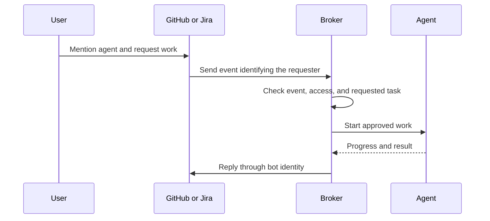
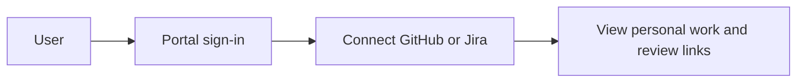
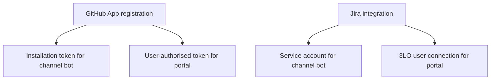

# Channel-Based Invocation and Portal Access

## 1. Purpose

Explain the interaction paths referenced by the [identity and access request](14-agent-workflow-automation-architecture.md).

## 2. What is a channel?

A channel is an existing collaboration tool where people discuss work.

In this design, channel examples are GitHub issues, pull requests, and Jira issue comments.

The channel is not a separate screen in the portal.

## 3. What is channel-based invocation?

A user requests agent work inside the collaboration tool.

For example, a user mentions the agent in an issue comment and asks it to research a problem.

The user stays in the tool where the work discussion already exists.

The broker is the backend service that receives the request and coordinates execution.

The bot identity reads permitted context and posts the reply.

## 4. What is the portal?

The portal is a supplementary web interface for the same workflow.

It lets users sign in, connect provider accounts, find work, and view information available to them.

The portal uses the person's provider connection for personal views.

It does not need the bot's broader access to show the person's information.

A portal action that starts agent work must pass the same requester, resource, and task checks.

## 5. Why do the paths use different credentials?

| Question | Channel invocation | Portal personal access |
| --- | --- | --- |
| Where does the user interact? | Existing GitHub or Jira discussion | Web application |
| What starts the interaction? | Mention or supported command | Sign-in and portal action |
| Who owns the request? | Person identified by the provider event | Signed-in person |
| Which identity posts automation replies? | GitHub App or Jira service account | Personal views do not need bot replies |
| Which credential reads personal views? | Not the purpose of this path | User-authorised provider token |
| Where are shared work records? | Provider issues, plans, PRs, and Project views | The same provider records |

The requester's identity and automation identity answer different questions.

The requester identifies who asked. The automation credential determines what the integration can technically do.

The broker must prevent automation from exceeding the requester's authorised task scope.

## 6. How each provider supports the paths

GitHub supports both roles through one App registration, with different token types.

Jira uses a service account for bot operations and a 3LO OAuth app for personal portal access.

The [identity and access request](14-agent-workflow-automation-architecture.md) defines the permissions requested for each role.
