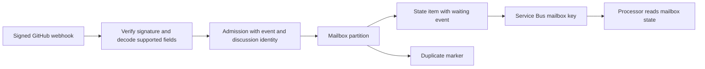
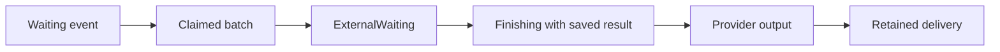
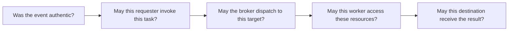

# Azure broker: storage, events, remote execution, and security

Research date: 2026-11-07.

## 1. Findings

Cosmos DB stores the broker's working state, including decoded GitHub event data.

Service Bus carries a mailbox key that tells the Processor where to look.

Event processing separates webhook receipt from task processing and channel replies.

Remote dispatch separates broker control from agent execution. It is an execution choice, not an event-processing requirement.

The current implementation uses GitHub Actions for `/research`. Other GitHub prompts use the in-process echo agent.

An external dispatcher gains privileged automation access. Approve its target resources, credentials, workflow code, and callback policy together.

## 2. Evidence and boundaries

This review examined current local source and the installed channel SDK. It also checked official GitHub and Microsoft documentation.

Examples use invented identities and credentials. They describe application-written JSON, without Cosmos system properties.

The examples were generated through local schemas and the Cosmos adapter, using the existing fake container.

Waiting-worker and result snapshots simulate lifecycle positions. They do not demonstrate a complete production execution.

This review made no production data reads and started no workflow. Earlier live observations remain in the wiring record.

Source risks below are findings about code. They do not establish that an attacker exploited a deployed service.

## 3. What Cosmos stores

Terraform creates database `slop`, container `mailbox`, and partition key path `/pk`.

The container holds four application item types.

| Item | Item ID | Partition key | Purpose | Automatic expiry |
| --- | --- | --- | --- | --- |
| Mailbox state | `state` | Discussion mailbox key | Waiting events, active delivery, output, and retained deliveries | None by default |
| Duplicate marker | `evt#<namespace>\|<provider>\|<eventId>` | Same discussion mailbox key | Reject a repeated admitted event | 30 days |
| Subscription marker | `sub` | Same discussion mailbox key | Record discussion subscription | None by default |
| Pending research | `research#<deliveryId>` | `pending-research` | Authorise worker callbacks through a saved delivery credential | 15 minutes |

The subscription item exists only when subscription code creates it. The current GitHub mention handler does not subscribe discussions.



### 3.1 The mailbox key

The SDK uses a key with length-prefixed segments. It does not use an issue number alone.

For installation `100`, repository `200`, and issue `42`, the key is:

```text
17:slop-code-factory|6:github|3:100|22:github:v1:200:issue:42
```

The segments identify application namespace, channel provider, installation, and discussion resource.

Two repositories can both have issue `42` without sharing a mailbox.

### 3.2 Mailbox state fields

| Field | Meaning |
| --- | --- |
| `id` | Always `state` within the discussion partition |
| `pk` | Discussion mailbox key |
| `state.mailboxKey` | Same discussion key, used by the shared mailbox model |
| `state.provider` | Channel provider, currently `github` on Azure |
| `state.nextSequence` | Sequence number assigned to the next arriving event |
| `state.waiting[]` | Events that have not entered the active batch |
| `waiting[].sequence` | Local arrival sequence, starting at zero |
| `waiting[].arrivedAt` | Broker receipt time in Unix milliseconds |
| `waiting[].admission` | Routing identity, event identity, and parsed provider payload |
| `state.deliveries.active` | Active batch, claim, attempt, credential, deadlines, and output |
| `state.deliveries.readyAt` | Next processing time in Unix milliseconds, or `null` |
| `state.deliveries.retained[]` | Limited records of completed deliveries |
| `version` | Application counter for conditional updates |
| `due` | Whether `readyAt` is non-null; it does not mean that work is due now |
| `dueAt` | Copy of `readyAt`, used by the due-mailbox query |

Cosmos adds properties such as `_etag` and `_ts`. The adapter uses ETags to prevent concurrent overwrites.

`version` and `_etag` serve related checks. They are different fields with different owners.

### 3.3 The event payload

The provider verifies the original request bytes before decoding the JSON.

It stores a decoded event envelope under `admission.payload`. It does not archive the original HTTP request bytes.

An issue-comment admission contains these fields:

```json
{
  "_tag": "DeliveryAdmission",
  "namespace": "slop-code-factory",
  "provider": "github",
  "installationId": "100",
  "resourceId": "github:v1:200:issue:42",
  "eventId": "11111111-2222-4333-8444-555555555555",
  "payload": {
    "event": "issue_comment",
    "payload": {
      "action": "created",
      "installation": { "id": 100 },
      "repository": {
        "id": 200,
        "name": "demo",
        "owner": { "login": "example-team" }
      },
      "issue": {
        "id": 400,
        "number": 42,
        "title": "Research retry behaviour",
        "body": "Explain retry handling.",
        "state": "open",
        "html_url": "https://github.com/example-team/demo/issues/42",
        "user": { "id": 300, "login": "maintainer-example", "type": "User" }
      },
      "comment": {
        "id": 500,
        "body": "@example-bot /research Explain retry handling.",
        "html_url": "https://github.com/example-team/demo/issues/42#issuecomment-500",
        "user": { "id": 300, "login": "maintainer-example", "type": "User" }
      },
      "sender": { "id": 300, "login": "maintainer-example", "type": "User" }
    }
  }
}
```

The event snapshot includes text, identities, and resource references. It is sensitive application data.

The tested schema removes unsupported input fields. Supported schemas differ for PRs, reviews, and other events.

Webhook secrets, App private keys, and installation tokens are not fields in this admission model.

### 3.4 Example duplicate marker

```json
{
  "id": "evt#slop-code-factory|github|11111111-2222-4333-8444-555555555555",
  "pk": "17:slop-code-factory|6:github|3:100|22:github:v1:200:issue:42",
  "ttl": 2592000
}
```

The adapter creates this marker and writes the mailbox in one transactional batch.

Both items share one partition key. Cosmos batches make those writes succeed or fail together.

This protects event admission. It does not make a later GitHub API call part of the same transaction.

Provider reference: [Cosmos transactional batches](https://learn.microsoft.com/en-us/azure/cosmos-db/transactional-batch).

### 3.5 Example pending research record

This shortened example uses a placeholder delivery ID.

```json
{
  "id": "research#<deliveryId>",
  "pk": "pending-research",
  "deliveryId": "<deliveryId>",
  "repositoryId": "200",
  "installationId": "100",
  "accessToken": "EXAMPLE_ONLY_NOT_A_REAL_CREDENTIAL",
  "expiresAt": 1794053704000,
  "ttl": 900
}
```

`accessToken` is an internal delivery credential. It is not a GitHub installation token or a GitHub OIDC token.

The proxy uses it after validating the runner's identity. The current dispatch payload does not contain it.

All pending records share one logical partition. This simplifies point reads but concentrates traffic.

### 3.6 What changes during execution



Claiming moves admissions from `waiting` into `active.admissions`.

The active record adds a batch ID, access credential, claim ID, stage, and attempt count.

Handoff records the worker deadline. The current shared handoff uses ten minutes of inactivity.

A result stores its terminal outcome and a pending `PresentOutcome` operation.

The Processor later posts that operation to GitHub. A provider outage retries output separately from task execution.

The SDK retains at most twenty finished deliveries, with seven-day retention timestamps.

These timestamps do not create Cosmos item TTLs. Lifecycle transitions prune entries; they do not guarantee immediate physical deletion.

The main state item has no automatic expiry. Define an explicit policy for idle mailboxes and stored credentials.

### 3.7 What Service Bus stores

The message body contains only this object:

```json
{
  "mailboxKey": "17:slop-code-factory|6:github|3:100|22:github:v1:200:issue:42"
}
```

The queue message means: check this mailbox. Cosmos remains the authority for due work and claim ownership.

The current design is mutable mailbox state with queued activation. It is not a complete event-sourcing history.

### 3.8 Data-model limits

The entire waiting list and active delivery share one state item. Each change rewrites that item.

Large event bursts or large results can therefore increase write cost, contention, and document size.

Microsoft documents a two-megabyte item limit. Bound text size and waiting capacity before the limit becomes a failure.

Provider reference: [Cosmos item limits](https://learn.microsoft.com/en-us/azure/cosmos-db/concepts-limits).

Cosmos TTL uses seconds since the last item modification. Application timestamps here use Unix milliseconds.

The container uses default TTL `-1`. Items expire automatically only when they carry their own positive TTL.

The pending reader also checks `expiresAt`, which supplies an application access deadline.

Provider reference: [Cosmos TTL behaviour](https://learn.microsoft.com/en-us/azure/cosmos-db/time-to-live).

## 4. Why process events asynchronously?

GitHub expects a successful webhook response within ten seconds. It recommends queue-based processing for slower work.

The Receiver can save the event and return before research or provider output completes.

Provider reference: [GitHub webhook best practices](https://docs.github.com/en/webhooks/using-webhooks/best-practices-for-using-webhooks).

| Need | Current mechanism | Remaining limit |
| --- | --- | --- |
| Return promptly | Save before later processing | Storage latency still affects webhook receipt |
| Handle bursts | Queue messages activate workers | Control concurrency and measure backlog |
| Preserve discussion control | Claims protect one active delivery | Arrival sequence does not establish provider event order |
| Wait without keeping a request open | Save `readyAt`; schedule a message | Scheduling and runtime delays remain possible |
| Recover a lost message | Minute timer scans due mailboxes | Recovery needs a healthy timer and database |
| Retry a failed reply | Save output before posting | Provider writes can repeat after uncertain responses |

Queues can smooth load and separate intake from processing. They also add delay, duplicate handling, and operational work.

A queue is less useful when work is predictably brief and the caller needs an immediate result.

Provider reference: [Azure queue-based load leveling](https://learn.microsoft.com/en-us/azure/architecture/patterns/queue-based-load-leveling).

This design must tolerate repeated and delayed processing. It must not promise exactly-once external effects.

GitHub can deliver events out of order. Use provider state or timestamps when event order affects a decision.

Provider reference: [GitHub webhook troubleshooting](https://docs.github.com/en/webhooks/testing-and-troubleshooting-webhooks/troubleshooting-webhooks).

The timer repairs lost mailbox activation. It cannot determine whether an uncertain external dispatch started a workflow.

## 5. Why dispatch research remotely?

The broker controls who can request work, which resources it permits, and where results return.

The worker supplies tools, compute, repository access, and the agent runtime.

Separating these roles lets the broker stay available while research runs elsewhere.

The current Function host sets a thirty-second timeout. Remote work can outlive that invocation.

This separation is an architectural inference from the code and stated requirements. It is not a requirement to use GitHub Actions.

| Execution choice | Useful when | Main cost |
| --- | --- | --- |
| In-process worker | Tasks are short and resource needs are small | Task failure and broker lifetime remain coupled |
| GitHub Actions | Teams own workflows and need repository tools or PR output | GitHub permissions, queue time, and workflow security |
| Cloud sandbox | Tasks need controlled runtime or network access | Sandbox lifecycle, identity, and image management |
| Worker pulls approved tasks | The broker should not hold dispatch access | Worker polling, task leasing, and worker registration |

These are design options. They are not all implemented.

### 5.1 The current outgoing call

The broker authenticates as the GitHub App, obtains an installation token, and posts this event:

```http
POST /repos/example-team/demo/dispatches
Authorization: Bearer <installation-token>
```

```json
{
  "event_type": "slopcodebot-research",
  "client_payload": {
    "task": "Explain retry handling.",
    "issueNumber": 42,
    "deliveryId": "<deliveryId>",
    "brokerOrigin": "https://broker.example.invalid"
  }
}
```

Workspace repositories also receive the selected `workspace` field.

The broker dispatches to the originating repository. It does not select an arbitrary workflow file in this call.

Matching `repository_dispatch` workflows receive the event. More than one matching workflow can run.

The workflow must exist on the default branch. Protect that branch and review matching event handlers.

Provider reference: [repository dispatch trigger](https://docs.github.com/en/actions/reference/workflows-and-actions/events-that-trigger-workflows#repository_dispatch).

GitHub requires Contents write for this endpoint. A `204` response means acceptance, not task completion.

Provider reference: [repository dispatch API](https://docs.github.com/en/rest/repos/repos#create-a-repository-dispatch-event).

### 5.2 Consider workflow dispatch separately

`workflow_dispatch` targets a named workflow and a branch or tag reference.

It requires Actions write rather than Contents write. That is a different permission boundary, not automatically a safer one.

Current documentation describes a response with a run ID. The broker currently pins API version `2022-11-28`.

Verify version-specific behaviour before relying on that response or changing the integration.

Provider reference: [workflow dispatch API](https://docs.github.com/en/rest/actions/workflows#create-a-workflow-dispatch-event).

## 6. Security considerations for an external broker

### 6.1 Separate four access decisions



A valid webhook signature does not authorise the commenter. An App installation does not inherit the commenter's resource permissions.

An OIDC token identifies a workflow job. It does not prove that the broker assigned that job this task.

### 6.2 Required controls and current findings

| Boundary | Threat | Control | Current evidence |
| --- | --- | --- | --- |
| Webhook intake | Forged event | Verify HMAC over original bytes; require HTTPS | SDK verifies HMAC before decoding |
| Replay | Repeated valid body with a changed delivery header | Add signed-body or business-event replay checks | Current marker uses the delivery header |
| Requester | User invokes the App's broader access | Check requester, operation, and every target resource | Current GitHub policy checks write access in the source repository |
| Dispatch target | User selects another repository or workflow | Resolve targets from approved server-side configuration | Current target comes from the GitHub discussion reference |
| App credential | Stolen private key permits token creation | Keep key in controlled backend storage; rotate and limit custody | Broker loads the App key through configuration |
| Installation token | One dispatch token reaches other repositories | Request exact repository IDs and minimum permissions | Current request supplies neither restriction |
| Workflow code | A changed workflow steals credentials | Protect workflow changes; pin reviewed dependencies | Requires repository governance and runner review |
| Task input | Comment text becomes shell commands | Validate fields; pass text through quoted environment variables | Task text remains untrusted after broker approval |
| Callback origin | A payload redirects an OIDC token | Configure an approved callback origin in the worker | Current payload carries `brokerOrigin`; do not trust arbitrary supplied URLs |
| Callback assignment | Another eligible run updates a known task | Bind assignment to task, run, attempt, and approved workflow revision | Current pending record has no run or attempt binding |
| Result disclosure | Private findings return to a broader audience | Check source and destination audiences | Source-repository write access alone does not establish this boundary |
| Stored data | Database readers obtain text or delivery credentials | Narrow data access; mask logs; define retention and credential protection | State and pending records contain readable application credentials |
| Availability | Replays or large tasks cause cost and backlog | Limit task rate, size, attempts, duration, and concurrency | Application scale limits alone do not provide per-requester admission limits |

The replay finding is a code-based inference. GitHub signs payload contents, not the delivery header used by this marker.

An attacker would need a valid captured body and signature. A changed header can then create another admission identity.

Preserve legitimate edited events when defining a business-event key. Do not deduplicate every edit using comment ID alone.

Provider reference: [GitHub signature validation](https://docs.github.com/en/webhooks/using-webhooks/validating-webhook-deliveries).

GitHub permits installation-token requests restricted by repository and permission. Omitted restrictions retain the installation's available grants.

Provider reference: [installation-token restrictions](https://docs.github.com/en/apps/creating-github-apps/authenticating-with-a-github-app/generating-an-installation-access-token-for-a-github-app).

Use read-only default job tokens. Increase permissions only for the job that needs the write.

Pass untrusted expressions through environment variables. Pin external actions to reviewed full commit SHAs.

Provider reference: [GitHub secure workflow use](https://docs.github.com/en/actions/reference/security/secure-use).

A compromised runner can steal referenced credentials and send private data elsewhere. Log masking does not prevent intentional extraction.

Do not put an App private key in an agent environment unless its full authority is acceptable there.

Provider reference: [compromised runner risks](https://docs.github.com/en/actions/concepts/security/compromised-runners).

Cosmos encrypts stored data by default. Authorised application readers can still obtain the credential values.

Application-level credential encryption or a credential service requires a separate design decision. Display redaction does not encrypt storage.

Provider reference: [Cosmos encryption at rest](https://learn.microsoft.com/en-us/azure/cosmos-db/database-encryption-at-rest).

### 6.3 Current callback checks

The proxy checks signature, issuer, audience, token time, repository ID, workflow reference, and pending-record expiry.

It forwards accepted operations with the internal delivery credential. The worker does not receive that credential from this proxy.

It does not compare `run_id` or `run_attempt` with an assigned execution.

If another eligible run knows an unexpired delivery ID, the current checks do not distinguish that run.

Bind the task to an independently verified assignment. Do not treat the first claimant as authorised merely because it arrives first.

The proxy requires `job_workflow_ref`. GitHub documents that claim for reusable workflow jobs.

Use the appropriate claim model for the chosen workflow structure. Validate real tokens before changing the policy.

Provider reference: [GitHub OIDC claim definitions](https://docs.github.com/en/actions/reference/security/oidc).

### 6.4 Dispatch recovery is also a security concern

Pending save, remote dispatch, and mailbox handoff occur in separate operations.

A lost response after GitHub acceptance can leave the broker uncertain whether the task started.

Blind retries can duplicate work, spending, and repository writes.

Save dispatch intent with the task transition. Give each task and attempt stable identities.

Make the worker reject duplicate starts. Reconcile uncertain dispatches before creating another attempt.

A transactional outbox preserves intent. It cannot make GitHub API calls part of a Cosmos transaction.

Microsoft describes Cosmos outbox publication through its change feed and a message relay.

Provider reference: [Cosmos transactional outbox](https://learn.microsoft.com/en-us/azure/architecture/databases/guide/transactional-out-box-cosmos).

The mailbox handoff uses ten minutes of inactivity. Pending callback access expires after fifteen minutes without renewal.

Coordinate queue delay, execution duration, heartbeat policy, cancellation, and late-result handling.

## 7. Recommended implementation order

1. Define the task contract: requester, resources, operation, destination, deadline, task ID, and attempt ID.
2. Narrow dispatcher credentials and use approved server-side target selection.
3. Verify workflow identity claims and bind callbacks to assigned runs and attempts.
4. Add dispatch intent, worker deduplication, and uncertain-dispatch reconciliation.
5. Bound event size, mailbox growth, task rate, credential lifetime, and stored-data retention.
6. Separate research permissions from publication permissions where practical.
7. Test the complete path with duplicate events, lost responses, delayed jobs, and compromised-input scenarios.

Keep the broker as the task authority. Keep execution services behind adapters with the same task contract.

## 8. Local source references

- [Azure composition](../infra/azure/src/Production.ts)
- [HTTP, queue, and timer handlers](../infra/azure/src/Handlers.ts)
- [Mailbox schema](../infra/azure/src/MailboxState.ts)
- [Mailbox admission and claims](../infra/azure/src/MailboxTransitions.ts)
- [Mailbox store](../infra/azure/src/MailboxStore.ts)
- [Cosmos item writes](../infra/azure/src/CosmosMailboxTable.ts)
- [Cosmos SDK calls and due query](../infra/azure/src/CosmosContainer.ts)
- [Pending callback records](../infra/azure/src/PendingResearch.ts)
- [Research dispatch sequence](../infra/azure/src/ResearchAgentSessions.ts)
- [GitHub authentication and dispatch](../infra/azure/src/GithubDispatch.ts)
- [Callback checks](../infra/azure/src/OidcProxy.ts)
- [Service Bus message format](../infra/azure/src/ServiceBusNudger.ts)
- [Cosmos infrastructure](../infra/azure/terraform/cosmos.tf)
- [Shared handoff](../packages/core/src/Handoff.ts)
- [Requester check](../packages/core/src/channels/GithubMention.ts)
