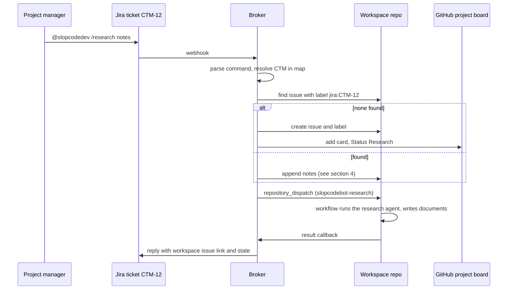
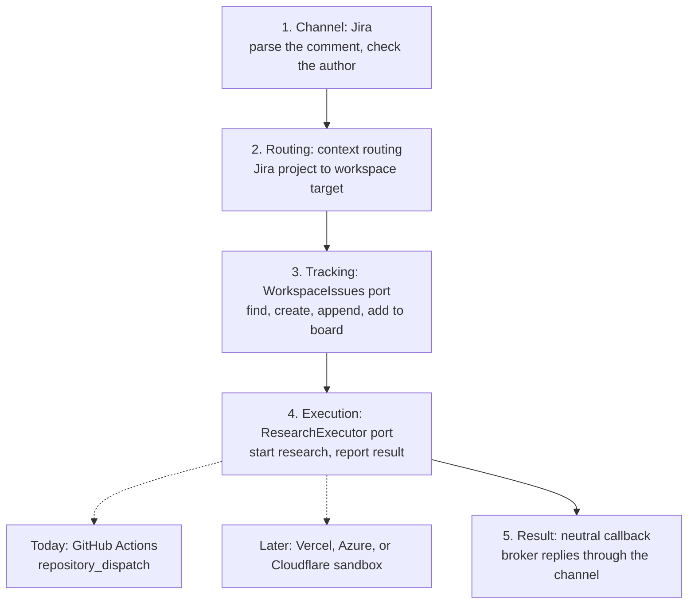
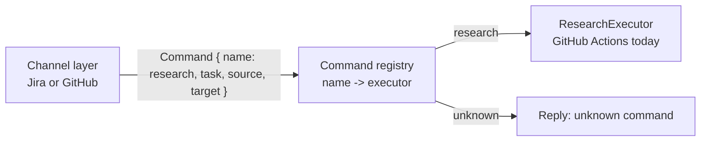
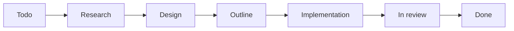

# Jira Research Invocation

Status: design. Context routing is built. The issue creation and handler wiring are not.

Project managers work in Jira. A Jira comment starts research. The research lands in a workspace repo.

## 1. The flow

A person comments `@slopcodedev /research` on a Jira ticket. The broker turns it into a GitHub issue. The research runs in the workspace repo, not in the Jira handler.



The Jira handler does not run an agent. The `/research` path does not use the AgentSession.

## 2. Layers

Each layer knows only the port of the layer below. This lets us swap one layer without a change in the others. Today the research agent runs in the workspace repo's GitHub Actions workflow. Later it may run in a sandbox on Vercel, Azure, or Cloudflare.



| Layer | Port (in `packages/core`, no cloud names) | Today's implementation |
| --- | --- | --- |
| 1. Channel | Jira event in, reply out | Jira mention parser, Jira comment reply |
| 2. Routing | `routeContext` (pure) | `ContextRouting.ts` |
| 3. Tracking | `WorkspaceIssues` | GitHub App: issues, labels, project board |
| 4. Execution | `ResearchExecutor` | GitHub Actions via `repository_dispatch` |
| 5. Result | Callback with run ID and status | Open decision: the existing `/research-session/{id}/...` endpoints finish an AgentSession delivery, and a Jira run has none |

Rules:

- The channel layer never names GitHub. The execution layer never names Jira.
- The execution port takes a neutral request: the task text, the workspace target, the issue reference, and a delivery ID. It returns a handle, not a GitHub run ID.
- A new executor must call back the same way the workflow does. It needs no change in layers 1 to 3.
- `packages/core` stays cloud neutral. Implementations of ports 3 and 4 live in `infra/azure/src`.

## 3. How a command reaches an executor

Today the broker finds "research" by matching text, in three places:

| Where | What it matches |
| --- | --- |
| `JiraCommand.ts` | `/research` as the first word after the Jira mention. |
| `ResearchCommand.ts` | `@bot /research --ws <id>` in a GitHub comment. |
| `ResearchAgentSessions.ts` (Azure) | `@name /research` at the start of the prompt text. |

The channel builds a prompt string and calls `AgentSessions.send`. The Azure layer reads that string. A match sends a dispatch to GitHub Actions. No match goes to the echo agent.

The Jira prompt is the ticket title and description plus the notes. It has no `@name /research` prefix, so on Azure a Jira `/research` goes to the echo agent today.

Proposed: the channel layer builds a typed command. The execution layer picks an executor by the command name. No layer reads prompt text.



## 4. Context routing

The map is a broker app setting, `JIRA_CONTEXT_ROUTES`, as JSON. One Jira project maps to one workspace repo.

```json
{
  "CTM": { "repo": "acme/ceylon-workspace", "workspace": "be", "board": 4 },
  "default": { "repo": "acme/ceylon-workspace", "workspace": "be", "board": 4 }
}
```

| Field | Meaning |
| --- | --- |
| Key | Jira project key. `default` serves projects with no entry. |
| `repo` | Workspace repo, as `owner/name`. |
| `workspace` | Default `--ws` value for research. |
| `board` | GitHub project number for the new issue. Optional. |

Code: `packages/core/src/channels/ContextRouting.ts`. It parses and looks up. It does no I/O.

## 5. A second `/research` on the same ticket

Each workspace issue carries the label `jira:<KEY>`. The broker finds the issue by this label, then acts by its state.

| Existing issue | Broker action |
| --- | --- |
| None found | Create the issue and label. |
| Todo or Research, no run active | Append the notes and run research again. |
| Research, run active | Append the notes only. |
| Design, Outline, Implementation, In review | Append the notes only. Start no new run. |
| Done or closed | Create a new issue. Link the old one. |

To research again at a later stage, a person moves the card back to Research.

Reading the board Status needs Projects permission on the GitHub App. Without it, the broker uses only open or closed plus the label.

## 6. Board

The ceylon-tea-mates board (org project 4) holds workspace tasks and repo issues. Repo issues are sub-issues of the workspace task. Group by **Parent issue** to see all implementation tickets for one task.



| Field | Values |
| --- | --- |
| Status | Todo, Research, Design, Outline, Implementation, In review, Done |
| Workflow | Design discussion, PRD + TDD, TDD, Research only |

## 7. Current code versus this design

| Part | State |
| --- | --- |
| `/research` parsing for Jira | Built (`JiraCommand.ts`). |
| Context routing parsing and lookup | Built. |
| Reading `JIRA_CONTEXT_ROUTES` in broker config | Not built. |
| Find, create, and append workspace issues | Not built. |
| Handler wiring and Jira reply | Not built. |
| Azure Jira webhook route, provider, and `JiraApi` layer | Not built. Azure wires only GitHub today. Jira is wired only on Cloudflare. |
| Repo ID and installation ID lookup by repo name | Not built. Pending research records take them from a GitHub discussion reference. |

Today `decideJiraMention` hands a mention to the issue's AgentSession. For `/research`, this design replaces that step. The handler creates or updates the workspace issue and sends the dispatch. The workspace workflow does the research.

The Azure broker already dispatches `slopcodebot-research` to a repo, but only to the repo where the comment came from. A Jira comment has no such repo, so the broker uses the map to choose the workspace repo.
