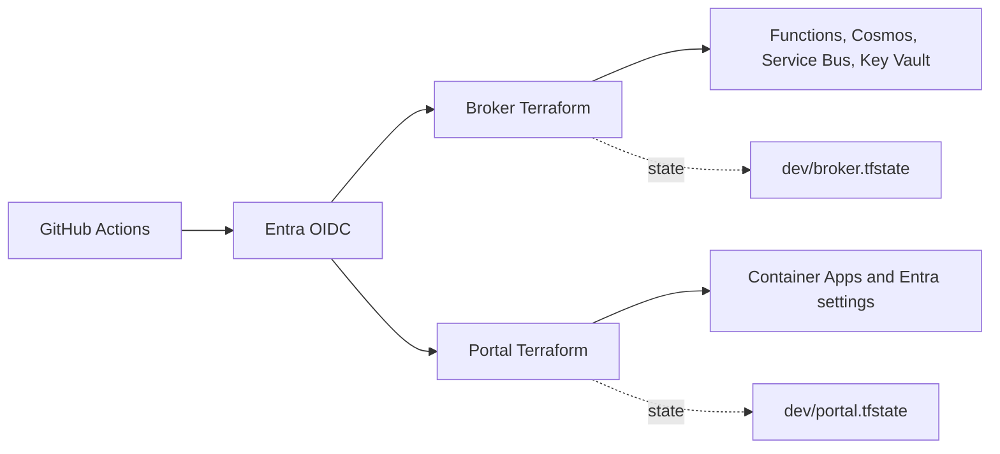
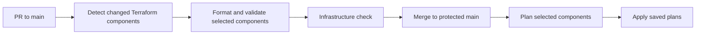
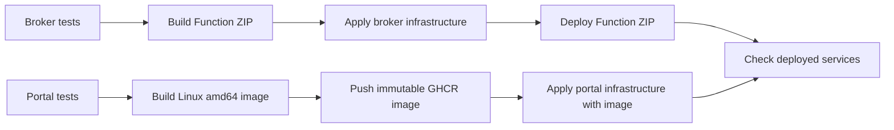

# Azure deployment with GitHub Actions

Use the existing Terraform configurations. Keep broker and portal state separate.
The example validates pull requests to `main`. It deploys relevant infrastructure changes after merge.

[Workflow example](examples/azure-infra.workflow.yml)



## 1. Prepare shared state

Both configurations currently use local state. GitHub runners need persistent state.
Create a dedicated Azure Storage account and a private container before deployment.
Keep this account outside both application configurations.
Enable blob versioning and soft delete. Restrict access to the state container.

Add this file to each Terraform folder:

```hcl
# backend.tf
terraform {
  backend "azurerm" {
    use_oidc         = true
    use_azuread_auth = true
  }
}
```

Migrate existing state from the machine that holds the current state.
Back up each state file first. Stop concurrent local deployments during migration.
Use the same account and container for both commands.
Replace the placeholders before execution.

```bash
# Run in infra/azure/terraform, using your existing Azure CLI session.
terraform init -migrate-state \
  -backend-config='use_oidc=false' \
  -backend-config='use_cli=true' \
  -backend-config='storage_account_name=<state-account>' \
  -backend-config='container_name=<state-container>' \
  -backend-config='key=dev/broker.tfstate'

# Run in portal/terraform.
terraform init -migrate-state \
  -backend-config='use_oidc=false' \
  -backend-config='use_cli=true' \
  -backend-config='storage_account_name=<state-account>' \
  -backend-config='container_name=<state-container>' \
  -backend-config='key=dev/portal.tfstate'
```

Read and accept each migration prompt. Check `terraform state list` after each migration.
CI initialization then uses OIDC from a fresh checkout.
For later local commands, retain the CLI backend overrides when reconfiguring authentication.

Azure Blob Storage supports state locking. OIDC can authenticate the backend through Entra ID.
See the [HashiCorp backend documentation](https://developer.hashicorp.com/terraform/language/backend/azurerm).

## 2. Create deployment identities

Create one Entra deployment application and service principal for each component.
Keep these separate from the portal sign-in application and the broker runtime identity.

Create GitHub environments named `azure-dev-broker` and `azure-dev-portal`.
Allow deployment from `main`. Match this branch in the example workflow.

Configure one federated credential per deployment application:

| Field | Value |
| --- | --- |
| Issuer | `https://token.actions.githubusercontent.com` |
| Audience | `api://AzureADTokenExchange` |
| Broker subject | `repo:<owner>/<repo>:environment:azure-dev-broker` |
| Portal subject | `repo:<owner>/<repo>:environment:azure-dev-portal` |

The job needs `id-token: write` to request its OIDC token.
Terraform uses this token directly. Add `azure/login` when deployment steps use Azure CLI.
See [Microsoft's OIDC guide](https://learn.microsoft.com/en-us/azure/developer/github/connect-from-azure-openid-connect).

Assign these permissions during initial setup:

| Identity | Permission | Scope |
| --- | --- | --- |
| Both | Storage Blob Data Contributor | State container |
| Broker | Contributor | Broker resource group |
| Broker | Role Based Access Control Administrator | Broker resource group |
| Portal | Contributor | Portal resource group |
| Portal | Microsoft Graph `Application.ReadWrite.OwnedBy` | Admin consent; ownership of the portal sign-in application |

Contributor alone cannot create the broker's Azure role assignments.
The portal also changes Entra redirect URIs and federated credentials.
Azure resource roles do not grant Microsoft Graph permissions.
See the provider documentation for [redirect URIs](https://github.com/hashicorp/terraform-provider-azuread/blob/main/docs/resources/application_redirect_uris.md).

Both Terraform configurations create their resource groups.
For resource group scopes, create these groups during setup. Import them into the existing states when absent.
Broker import address: `azurerm_resource_group.main`. Portal import address: `azurerm_resource_group.rg`.
Skip import when the state already contains the resource group.
Register required Azure resource providers during setup if deployment identities cannot register them.

The broker also assigns its caller Key Vault Secrets Officer.
Changing the deployment identity can change this assignment. Review the first plan carefully.

## 3. Set GitHub configuration

Set these variables in both GitHub environments:

| Variable | Value |
| --- | --- |
| `AZURE_CLIENT_ID` | Component deployment application client ID |
| `AZURE_TENANT_ID` | Entra tenant ID |
| `AZURE_SUBSCRIPTION_ID` | Target subscription ID |
| `TF_STATE_ACCOUNT` | State Storage account name |
| `TF_STATE_CONTAINER` | Private state container name |
| `TERRAFORM_VERSION` | One tested, exact Terraform version, at least 1.6 |

Set these additional variables in `azure-dev-portal`:

| Variable | Value |
| --- | --- |
| `PORTAL_APP_CLIENT_ID` | Existing portal sign-in application client ID |
| `PORTAL_IMAGE` | Existing public GHCR image with an immutable tag or digest |
| `PORTAL_CUSTOM_DOMAIN` | Current custom domain, or empty |
| `PORTAL_DNS_READY` | `true` only after domain validation records exist |
| `PORTAL_GITHUB_AUTH_MODE` | Existing `app` or `oauth` mode |
| `PORTAL_GITHUB_CLIENT_ID` | Existing GitHub client ID, when enabled |
| `PORTAL_ATLASSIAN_CLIENT_ID` | Existing Atlassian client ID, when enabled |
| `PORTAL_ATLASSIAN_SCOPES` | Current custom scopes, or empty for defaults |

Set the corresponding environment secrets:

- `PORTAL_GITHUB_CLIENT_SECRET`, when GitHub is enabled.
- `PORTAL_ATLASSIAN_CLIENT_SECRET`, when Jira is enabled.
- `PORTAL_TOKEN_ENCRYPTION_KEY`, when an explicit encryption key is already used.

Preserve existing portal settings. Empty provider inputs disable that provider on the next apply.
Do not generate a new encryption key on each deployment.
The migrated state preserves Terraform's existing generated key when no explicit key is used.

Portal secrets currently enter Terraform state. The sensitive flag only hides normal console output.
Protect state and plan files. Do not publish plan files as public artifacts.

Broker runtime secrets remain in Key Vault. Create the five required values before the first runtime check.
Their names appear in `infra/azure/terraform/main.tf`. The infrastructure workflow does not upload these values.

Commit both provider lock files. The example requires them with `-lockfile=readonly`.
Preserve broker variables from local `terraform.tfvars` in reviewed CI configuration.
The example uses broker defaults. Confirm the stage, region, budget, and allowed research workflow before deployment.

## 4. Run the infrastructure workflow

Copy `docs/examples/azure-infra.workflow.yml` to `.github/workflows/azure-infra.yml`.
Add both backend files. Finish state migration before the first CI run.
Pin action references to reviewed commit SHAs before production use.

Set `TERRAFORM_VERSION` at repository level. Validation jobs do not use deployment environments.

The workflow selects components from changed file paths:

| Changed files | Component jobs |
| --- | --- |
| `infra/azure/terraform/` Terraform files or lock files | Broker |
| `portal/terraform/` Terraform files or lock files | Portal |
| `.github/workflows/azure-infra.yml` | Both |
| Documentation or application source only | Neither |

The filter includes `.tf`, `.tf.json`, `.tfvars`, `.tfvars.json`, and `.hcl` files.
It detects deletions and both paths of renamed files.
Pull requests use the merge base. Pushes compare the previous and current commits.
A manual run selects both components.



1. Run the workflow manually from `main` with `action=plan` after setup.
2. Check both plans. Existing resources should remain under management.
3. Add a branch rule requiring pull requests and the `Infrastructure check` status.
4. Block direct pushes to `main`. Restrict bypass permissions.
5. Open a pull request that changes broker Terraform. Confirm only broker validation runs.
6. Merge the pull request. Confirm only broker infrastructure deploys.
7. Repeat with portal changes. Confirm documentation changes skip both component jobs.

Pull requests run formatting and validation without Azure credentials or state access.
The workflow does not create an authenticated Terraform plan on pull requests.
After merge, selected components run a fresh plan and apply it automatically.
Manual runs retain the `plan` and `apply` options.

The `Infrastructure check` job always reports a result, including when no component needs validation.
Use this stable check for branch protection. Do not require individual matrix jobs.
The workflow starts on all pull requests to `main`, but component jobs run only for relevant files.
This avoids pending required checks caused by workflow-level path filters.
See [GitHub workflow syntax](https://docs.github.com/en/actions/reference/workflows-and-actions/workflow-syntax).

For automatic development deployment, remove required reviewers from the two development environments.
Keep their deployment branch restriction set to `main`.
The two deployments can run independently. GitHub concurrency and backend locking protect each component.
One component can succeed while the other fails. Check both job results.
Configure GitHub failure notifications so a failed deployment receives attention.

A push trigger also receives direct pushes. Branch protection must enforce the pull-request requirement.
If merge queues are enabled, add `merge_group` support before requiring this workflow.

For production, add a plan job followed by a protected apply job.
Require environment review before the apply job starts.
Transfer the saved plan through a restricted artifact with short retention.
Use the same commit, Terraform version, lock file, and build artifacts in both jobs.
Configure OIDC trust separately for the plan and apply environments.

Give authenticated plans only to trusted code. Never execute untrusted pull-request code with deployment credentials.

## 5. Add application delivery

Infrastructure deployment creates resources. Application delivery supplies the runnable code.

### Include shared dependencies in delivery filters

A core change must rebuild and deploy the broker. The broker imports `@slop/core` into its Function bundle.
The portal currently has no direct core dependency. Its image build uses the `portal` directory.

Use these rules when adding application delivery jobs:

| Changed paths | PR checks | Delivery after merge |
| --- | --- | --- |
| `packages/core/src/**`, `packages/core/package.json` | Core and broker tests; broker build | Broker Function ZIP |
| `packages/core/test/**` | Core tests | None |
| `infra/azure/src/**`, `infra/azure/app/**`, `infra/azure/scripts/**`, `infra/azure/package.json`, `infra/azure/tsconfig.json` | Broker tests and build | Broker Function ZIP |
| Root `package.json` or `bun.lock` | Core and broker tests; broker build | Broker Function ZIP |
| `portal/app/**`, `portal/components/**`, `portal/lib/**`, `portal/auth.ts` | Portal tests and build | Portal container image |
| Portal dependency files, Dockerfile, or build configuration | Portal tests and build | Portal container image |
| Terraform configuration | Component validation | Component infrastructure |
| Documentation only | Stable status check | None |

Include shared compiler configuration and vendored packages when they affect the broker build.
Update these rules when an application gains a dependency. Core changes do not require infrastructure changes by themselves.
The infrastructure template currently filters Terraform files only. Application delivery jobs still need these additional filters.



Broker sequence:

1. Install workspace dependencies from the repository root with `bun install --frozen-lockfile`.
2. Run tests and type checks in `infra/azure`.
3. Run `bun run bundle` there. It creates `dist/app.zip`.
4. Apply broker Terraform with `package_path` unset when Azure CLI owns code deployment.
5. Read `function_app_name` from Terraform output. Use the broker resource group from configuration.
6. Sign in with `azure/login` through OIDC.
7. Deploy the ZIP with `az functionapp deployment source config-zip`.

Portal sequence:

1. Run `npm ci` and the portal tests in `portal`.
2. Build `portal/Dockerfile` for `linux/amd64`.
3. Push the image to GHCR with `packages: write` and the job's `GITHUB_TOKEN`.
4. Pass the immutable image reference as `TF_VAR_image` during the portal plan.
5. Apply that plan. Terraform updates the Container App revision.

The current Container App expects anonymous image pulls.
Make the GHCR package public once, or configure authenticated pulls before using a private image.
The existing portal deploy script combines build and apply. Its `--plan` mode also pushes an image.
Use separate workflow steps when builds and infrastructure reviews need separate controls.

Check portal HTTP responses and sign-in callbacks after deployment.
Check broker Functions, Key Vault references, and a controlled webhook delivery.
Complete custom-domain DNS validation before setting `PORTAL_DNS_READY=true`.

The portal uses fixed resource names. Separate state keys alone cannot create separate environments.
Parameterize portal names and its Entra application before adding staging or production.

## Scope of this example

This guide and template do not change Azure or activate a deployment workflow.
The template covers development infrastructure. Application build and deployment steps remain described above.
Complete identity setup and state migration before copying the template into the active workflow folder.
