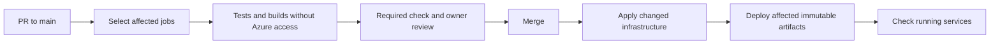
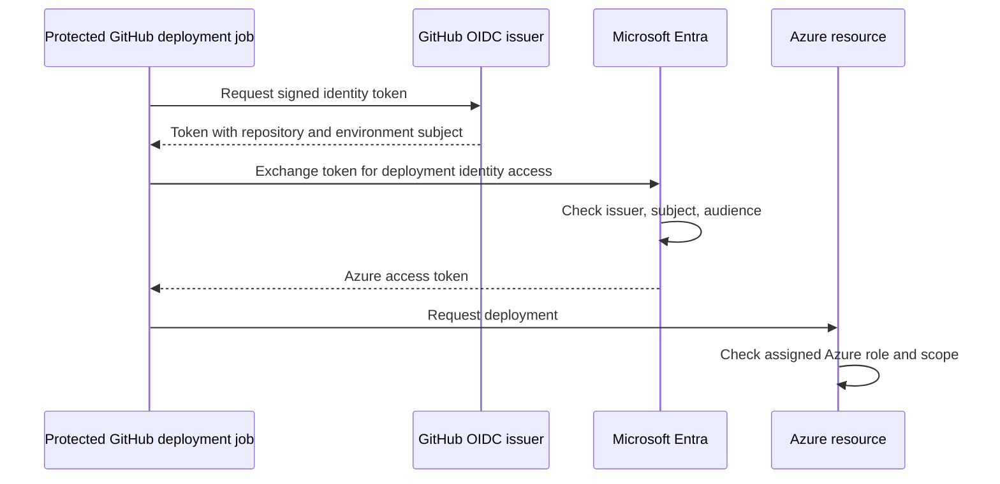

# Azure deployment implementation plan

Status: proposed. The existing example covers Terraform deployment only.
Application delivery, permission separation, and security changes below are not implemented.

## 1. Planned file changes

| File | Planned change |
| --- | --- |
| `.github/workflows/azure-infra.yml` | Validate PRs. Plan and apply selected infrastructure after merge to main. |
| `.github/workflows/azure-apps.yml` | Test, build, and deploy selected applications. Separate build jobs from deployment jobs. |
| `.github/scripts/deployment-changes.py` | Calculate separate core-test, broker-build, portal-build, broker-infra, and portal-infra flags. |
| `.github/scripts/test-deployment-changes.py` | Check core changes, deletions, renames, dependency changes, and unrelated paths. |
| `.github/CODEOWNERS` | Require designated owners for workflows, scripts, infrastructure, and the ownership file. |
| `.github/dependabot.yml` | Propose reviewed updates for pinned Actions and application dependencies. |
| `infra/azure/terraform/backend.tf` | Store broker state in Azure Blob Storage through Entra authentication. |
| `portal/terraform/backend.tf` | Store portal state separately through Entra authentication. |
| `infra/azure/terraform/outputs.tf` | Export nonsecret deployment names and resource IDs. |
| `portal/terraform/main.tf` | Expose deployment IDs. Use Key Vault references for application secrets. |
| `infra/azure/terraform/keyvault.tf` | Remove the automatic secret-management grant to the Terraform caller. |
| `infra/azure/bootstrap/` | Manage privileged identity settings and role bindings through an administrator process. |
| Broker role-assignment resources | Transfer permission management to the administrator setup state. |
| Portal Entra resources | Transfer redirect URIs and federation management to the administrator setup state. |
| `docs/18-azure-deployment-automation.md` | Document setup, migration, verification, rollback, and incident revocation. |

Owner names remain placeholders until you select the GitHub reviewers.
Preserve existing resource names and secret values during the first migration.
Move Terraform state entries when ownership changes. Do not recreate live identities or role bindings.

The portal currently stores user connection tokens on its container filesystem.
Redeployment can lose these files. Durable token storage needs a separate application change before production use.

## 2. Change rules

| Change | PR checks | Deployment after merge |
| --- | --- | --- |
| Core runtime source | Core and broker tests; broker build | Broker ZIP |
| Core tests only | Core tests | None |
| Broker runtime or build files | Broker tests and build | Broker ZIP |
| Root workspace dependencies | Core and broker tests; broker build | Broker ZIP |
| Portal runtime or build files | Portal tests and image build | Portal image |
| Broker Terraform | Broker Terraform validation | Broker infrastructure |
| Portal Terraform | Portal Terraform validation | Portal infrastructure |
| Shared deployment workflow or scripts | All affected checks | Both affected components |
| Documentation only | Stable required status | None |

Shared compiler configuration and vendored packages must select all consumers.
Infrastructure changes do not automatically require an application rebuild.
Changes that replace application resources must also redeploy the current application artifact.
Serialize infrastructure and application deployment for each component.
GitHub concurrency does not guarantee FIFO order. Check the latest main commit before starting a deployment.



Build artifacts from the merged commit in jobs without Azure credentials.
Deployment jobs download artifacts from that same workflow run.
Use image digests and ZIP checksums. Keep the previous successful artifacts for rollback.
Report component, source commit, artifact identifier, and deployment result.
PR checks do not use Azure state, application secrets, or deployment identities.

## 3. Azure trust

The workflow authenticates as a deployment identity. It does not authenticate as your personal Azure account.
Your account, or an administrator, creates the trust and permissions during setup.

Create four deployment applications and their service principals:

| Identity | GitHub environment | Intended routine access |
| --- | --- | --- |
| Broker infrastructure | `azure-dev-broker-infra` | Broker resource group and broker state container |
| Portal infrastructure | `azure-dev-portal-infra` | Portal resource group and portal state container |
| Broker delivery | `azure-dev-broker-app` | Code deployment to the broker Function App |
| Portal delivery | `azure-dev-portal-app` | Revision updates on the portal Container App |

These proposed environment names replace the two names in the earlier example.
Use one federated credential on each deployment application:

```json
{
  "name": "github-broker-app-dev",
  "issuer": "https://token.actions.githubusercontent.com",
  "subject": "repo:<owner>/<repo>:environment:azure-dev-broker-app",
  "audiences": ["api://AzureADTokenExchange"]
}
```

Change the subject environment for each identity. Match spelling and case exactly.
In Entra, use App registrations, then Certificates and secrets, then Federated credentials.
Select the GitHub Actions scenario and the Environment entity type.
Create no client secret for these deployment identities.



Federation establishes identity. Azure roles determine what that identity can do.
An environment subject does not itself restrict the branch or workflow filename.
GitHub environment rules must allow only main. Protect workflows with required owner review.
See [GitHub Azure OIDC guidance](https://docs.github.com/en/actions/how-tos/secure-your-work/security-harden-deployments/oidc-in-azure).
See [Entra trust setup](https://learn.microsoft.com/en-us/entra/workload-id/workload-identity-federation-create-trust).

## 4. Your setup tasks

You, or an administrator, must complete these account changes:

1. Select the Azure tenant, subscription, and deployment resource groups.
2. Confirm the GitHub repository owner and name. Select the required reviewers.
3. Create private state storage with separate broker, portal, and administrator setup containers.
4. Enable state versioning and soft delete. Back up and migrate existing local state.
5. Create the four deployment applications, service principals, and federated credentials.
6. Assign scoped roles after reviewing the planned permissions.
7. Create the four GitHub environments. Allow deployment only from main.
8. Protect main with required PRs, checks, owner reviews, and restricted bypass permissions.
9. Add client, tenant, subscription, state, and resource identifiers as GitHub environment variables.
10. Provision application secrets in Key Vault. Preserve the current encryption and authentication keys.
11. Complete the initial plan review and controlled development deployment.

Creating applications requires appropriate Entra permissions. Assigning Azure roles requires Azure authorization permissions.
These permissions are separate. A subscription administrator does not automatically have every Entra permission.
The administrator setup process needs permission to configure the portal application's Entra settings.
Use administrator consent only for permissions that the setup process actually requires.

Useful nonsecret setup information:

- GitHub owner, repository, deployment branch, and reviewer names.
- Azure tenant ID, subscription ID, and deployment resource groups.
- Portal sign-in application client ID and intended public hostname.
- Deployment application client IDs after creation.

Keep passwords, private keys, OAuth secrets, and encryption keys in approved secret stores.
The deployment client IDs identify applications. They are not client secrets.

## 5. Permissions and stronger security

### Routine infrastructure changes

Initially scope Contributor to each component resource group.
Grant Storage Blob Data Contributor only on that component's state container.
Use separate containers because blob key prefixes alone do not provide this role boundary.
Review narrower custom resource roles after verifying required Terraform operations.

Contributor alone cannot manage the current broker role assignments.
The current portal configuration also requires Graph application write permission.
Move those resources to the administrator setup process before removing those permissions from routine CI.

Routine workflows must not manage their own federation, role assignments, or secret-management grants.
New identities or replaced runtime resources can require an administrator setup update.
If automatic role management remains necessary, use conditional, restricted role delegation.
Do not grant unrestricted subscription Owner to CI.
See [Azure role delegation conditions](https://learn.microsoft.com/en-us/azure/role-based-access-control/delegate-role-assignments-overview).

### Routine application delivery

Broker delivery receives only the operations needed for Function code deployment, scoped to that Function App.
Portal delivery receives only the operations needed for revision updates, scoped to that Container App.
Validate the exact custom-role actions against the selected deployment commands during implementation.
Neither delivery identity needs Terraform state, Graph application administration, or Azure role assignment administration.

Use a single owner for the portal image property.
When application delivery owns revision updates, Terraform must stop reconciling that image property.
Persist the deployed digest for infrastructure replacement and recovery.
Avoid deploying an old Terraform image value over a newer application revision.

A deployer can run application code with the runtime identity's access.
Removing direct secret-read roles does not eliminate that indirect access.
Review runtime permissions and protect every path that can deploy code.

### Workflow and secret controls

- Grant `id-token: write` only to deployment jobs.
- Keep PR jobs without Azure credentials and deployment environments.
- Use `pull_request`, and do not execute PR code through privileged `pull_request_target` jobs.
- Pin Actions to reviewed full commit SHAs. Pin runtime tools and dependencies.
- Require owner approval for workflows, deployment scripts, Terraform, and security configuration.
- Build and test before requesting Azure deployment access.
- Push portal images with the workflow token and `packages: write` only in the publishing job.
- Use Key Vault references for portal secrets through its managed identity.
- Preserve secret values when moving them. Existing state versions can retain historical secret values.
- Restrict state and plan access. Keep plan artifacts private with short retention.
- Add dependency and image scanning. Fail releases for the agreed severity threshold.

See [GitHub secure workflow guidance](https://docs.github.com/en/actions/reference/security/secure-use).
See [Container Apps Key Vault references](https://learn.microsoft.com/en-us/azure/container-apps/manage-secrets).

Automatic development deployment can run after required PR review.
For production, add an independent deployment reviewer and prevent self-approval where supported.
Review environment protection availability for the repository's GitHub plan.
For private-only state access, use a runner with network access to the private endpoint.
Use a temporary isolated runner. Ordinary public runners cannot reach a private-only endpoint by default.

## 6. Delivery order and proof

1. Implement and check the change selector, tests, and PR jobs without Azure deployment access.
2. Prepare administrator setup, role separation, and state migration instructions.
3. Complete your account setup and migrate existing state ownership without resource destruction.
4. Review no-op plans before enabling the automatic infrastructure apply jobs.
5. Add broker builds and delivery. Check a core change deploys broker only.
6. Add portal builds and delivery. Check Terraform cannot overwrite its deployed image.
7. Add secret references, scanning, recovery checks, and production controls.

Initial setup has two phases. Create trust and resources first, then bind runtime permissions to their resource IDs.
Do not enable automatic delivery until both phases are complete.

Verify these boundaries:

| Scenario | Expected result |
| --- | --- |
| Documentation change | No build or Azure deployment |
| Core source change | Core and broker checks; broker delivery after merge |
| Portal source change | Portal checks and delivery only |
| Fork PR | Checks without Azure access |
| Feature branch requests a deployment environment | GitHub denies deployment |
| Unrelated repository requests the Azure identity | Entra rejects the subject |
| Delivery identity reads Terraform state | Azure denies access |
| Routine infrastructure identity changes role assignments | Azure denies access after permission separation |
| Old deployment run starts after a newer commit | Freshness check stops the old deployment |
| Deployment fails | Workflow fails and reports the affected component |

For emergency revocation, disable the deployment service principal and remove its federated credential.
Remove its role assignments and stop active workflow runs. Account for tokens that were already issued.
Keep the previous broker ZIP and portal image digest available for a reviewed rollback.
