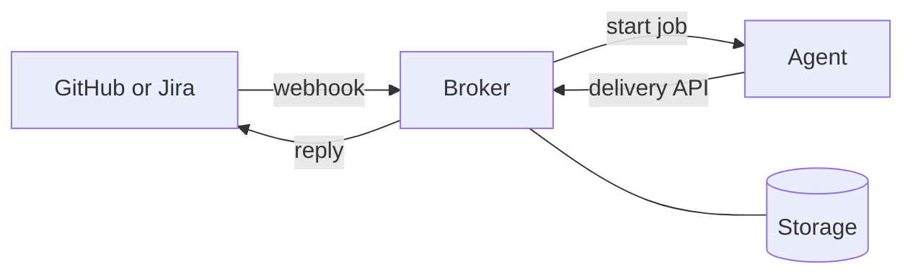

# Architecture

## Flow

1. The broker verifies the webhook signature.
2. The broker saves the event. It drops duplicates.
3. After a short quiet period, the broker runs the callback for the mailbox.
4. The callback starts the agent and hands off the delivery.
5. The agent reports through the delivery API with a delivery token.
6. The broker saves the output, then posts it to the provider.

The broker saves the event before the callback runs. It saves the output before it posts. A crash or a provider outage never loses work.

## Mailbox

- One mailbox for each conversation (a GitHub issue or pull request, or a Jira issue).
- The broker runs one delivery at a time for each mailbox.
- Different mailboxes run in parallel.

## Hosts

| Host | Storage | Wake-up | Where the agent runs |
|---|---|---|---|
| Cloudflare (`infra/cloudfare`) | Durable Object | Alarm | AgentSession Durable Object |
| AWS (`infra/aws`) | DynamoDB | SQS nudge and a sweep every minute | Inside the Processor Lambda |
| Azure (`infra/azure`) | Cosmos DB | Service Bus nudge and a sweep every minute | Inside the Processor. Research commands go to GitHub Actions. |

## Code

| Path | Contents |
|---|---|
| `packages/core` | Mention handlers, commands, echo agent, ports, shared tests |
| `infra/*` | Cloud wiring only |

Azure keeps a copy of the AWS mailbox logic. Change both together.

## Commands

| Provider | Behavior |
|---|---|
| GitHub | Any mention is a prompt. |
| Jira | `/research` starts a run. Other mentions are ignored. |

Details: [conversation-delivery-spec](conversation-delivery-spec.md).
