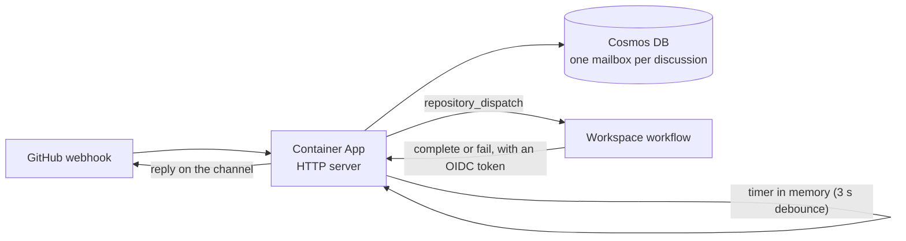

# azure/

**Role:** the control layer on Azure. One Container App receives GitHub webhooks, saves them to a Cosmos DB mailbox, waits a short time in memory, and starts the work. It has the same behaviour as `infra/aws`, with fewer parts.

**Status:** the code passes its tests against fakes (`bun run test`, `bun run typecheck`). The container image builds and its health check answers. The Terraform passes `terraform validate`. Nothing has been planned, applied or run against real Azure services. The Cosmos batch calls are untested against a real account.

## How it fits together

1. The webhook arrives at `POST /integrations/github/webhook`. The SDK's routes verify it. The event is saved to Cosmos, one item per mailbox plus dedup markers.
2. The save starts a timer in the app's memory (`InMemoryNudger`). The timer waits for the debounce (3 seconds).
3. When the timer fires, `processNudge` runs the SDK's mailbox engine for that mailbox. For `/research` it starts the customer's GitHub Actions workflow. Other prompts go to the echo agent.
4. The workflow reports `complete` or `fail` to `/research-session/{id}/...` with a GitHub OIDC token. The broker replies on the channel.

There is no queue, no sweep and no scheduled job. A nudge is a timer in memory.

The server (`src/server.ts`, started by `src/main.ts`) serves:

| Route | Use |
| --- | --- |
| `POST /integrations/github/webhook` | The GitHub webhook |
| `GET`, `POST`, `PUT`, `DELETE /deliveries/...` | The delivery API |
| `GET`, `PUT`, `POST /research-session/{id}/{action}` | The runner's calls, with a GitHub OIDC token |
| `GET /skills` | The skills list the runner installs |
| `GET /healthz` | Health check for the platform |

The mailbox logic (`MailboxState`, `MailboxTransitions`, `MailboxStore`, `Handlers`, `InProcessAgent`) is a copy of `infra/aws/src`. The Azure-specific files are `CosmosMailboxTable`, `CosmosContainer`, `InMemoryNudger`, `HttpAdapter`, `server`, `main`, `Config` and `Production`. A change to the shared logic has to be made in both folders until it moves into a shared package.

## Configuration

The Container App gets these settings from Terraform:

- `COSMOS_ENDPOINT`, `COSMOS_DATABASE`, `COSMOS_CONTAINER`
- `BROKER_PUBLIC_ORIGIN`: the app's public address. The runner calls it back. It is also the OIDC audience.
- `OIDC_ALLOWED_WORKFLOW_REF`: the exact `job_workflow_ref` values that may report. Today: `TheCloudPlumbingCo/slop-factory-pieces/.github/workflows/workspace.yml@refs/heads/main`.
- `AZURE_CLIENT_ID`: the app's managed identity. The app signs in to Cosmos with it. No key is stored.
- `PORT` (8080).
- The five GitHub settings, as Key Vault references: `GITHUB_WEBHOOK_SECRET`, `GITHUB_BOT_MENTION_NAME`, `GITHUB_BOT_USER_ID`, `GITHUB_APP_ID`, `GITHUB_PRIVATE_KEY`.

Terraform does not create the secrets. Create them in the Key Vault with the names `GITHUB-WEBHOOK-SECRET`, `GITHUB-BOT-MENTION-NAME`, `GITHUB-BOT-USER-ID`, `GITHUB-APP-ID`, `GITHUB-PRIVATE-KEY` (dashes, not underscores).

### The board card

The broker moves the card on the workspace's project board. The workflow does not. After GitHub accepts a dispatch for a workspace, the broker looks up the next column in `packages/core/src/CardStates.ts` (today: `research` and `HandedOff` give `Research`). It reads the project number from `workspaces/<id>/workspace.json` in the workspace repo.

The move runs in the background. A problem is logged and never fails the delivery. If the app stops at that moment, the card does not move.

The GitHub App must hold these permissions for the move: **Contents: read**, **Issues: read**, and the organisation permission **Projects: write**. The broker asks for a token with only the ones each call needs. If the App lacks one, GitHub refuses the token and the log says `could not move the card` or `could not read workspace.json`.

The app uses a user-assigned identity. Its roles must exist before the app reads the secrets. A system-assigned identity exists only after the app, so it would deadlock.

## Deploying

From the repo root:

- `npm run deploy:broker:plan` builds the image, pushes it, and runs `terraform plan`. Nothing changes in Azure.
- `npm run deploy:broker` does the same, asks "Apply this plan?", then applies and prints the outputs.
- Add `-- --yes` to skip the question.

The script needs `docker`, `terraform`, and a logged-in `az`. It also needs `docker login ghcr.io`. The image must be public, because the Container App pulls it with no credentials. The script checks this and tells you what to do.

**First time only.** The Container App reads the secrets when it is created, so the secrets must exist before the full apply.

1. `az login`, and `az account set --subscription <id>`.
2. Create only the vault: `cd terraform && terraform init && terraform apply -target=azurerm_resource_group.main -target=random_string.suffix -target=azurerm_key_vault.main -target=azurerm_role_assignment.deployer_manages_secrets`.
3. Create the five secrets: `az keyvault secret set --vault-name <key_vault_name> --name GITHUB-WEBHOOK-SECRET --value <value>`, and so on.
4. Run `npm run deploy:broker:plan`, read the plan, then run `npm run deploy:broker`.
5. Note the outputs: `webhook_url`, `broker_public_origin`, `key_vault_name`, `container_app_name`.
6. In the GitHub App's settings, set the webhook URL to `webhook_url` and the secret to the value of `GITHUB-WEBHOOK-SECRET`. An App has one webhook URL, so one deployment receives its events at a time.
7. Mention the bot on an issue. Expect an acknowledgement, then an echo reply about 5 seconds later.

Variables: `location` (default `southeastasia`), `stage` (default `dev`), `image`, `max_replicas` (default 2), `budget_alert_emails` (no budget is created while empty), `monthly_budget_usd`, `broker_public_origin`.

The steps above come from the tools' documentation. None has been run against real Azure.

## Known limits

- **A stopped app loses its timers.** The wait for a comment is a timer in memory. If the app restarts, crashes, scales to zero or is replaced during that wait, the timer is lost. The comment stays in Cosmos, but nothing wakes it. The user gets no reply and no error. They must comment again. Nothing recovers it, because there is no sweep.
- **A dead worker means a lost comment.** If a worker dies while it handles a mailbox, the lease runs out and nobody takes the work over. This is accepted for now.
- **No hand-off timeout.** The 10-minute limit for the runner's answer is also a timer in memory. If the app stops, it never fires. A run that dies, or never reports, leaves the discussion silent.
- **No retry.** A failed pass is logged and not retried. A mailbox that is due but finds no work is logged and left alone.
- **Cold start.** The app scales to zero. The first request after idle waits while the app starts. GitHub allows about 10 seconds for a webhook. The start time has not been measured.
- **Double hand-off.** A crash after the workflow starts and before the broker saves "handed off" can start the workflow twice. The dispatch carries a `runId` (the delivery id). The Action ends its issue comment with `<!-- slopfactory-run:RUN_ID -->` and skips a run if a bot comment with that marker exists. This does not cover two runs that overlap before the first comment: the workflow's concurrency group makes the second wait, so it sees the marker. It also skips a repeat of a run that failed. A new comment from the user has a new id and always runs.
- The Cosmos table is untested against a real account: the transactional batch with `ifMatch`, the cross-partition `due` query and the per-item `ttl` follow the SDK's types and documentation.
- Dedup markers are stored under the mailbox's partition key, so dedup is per mailbox, not global. That holds while one provider event always maps to one mailbox.
- Each replica reads its own clock for lease and `readyAt` times. A clock difference changes only when a lease counts as expired. It does not break the version check. Azure hosts sync their clocks, and `max_replicas` is 2.
- Everything the AWS README lists as a known limit for the shared logic applies here too.
