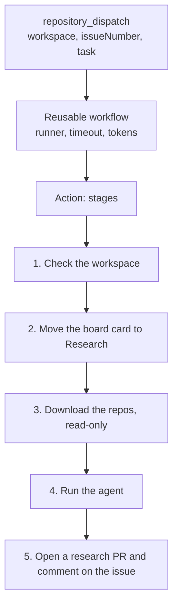

# rpi-workflow

A reusable GitHub workflow and Action. An organization adds one small file to its workspace repo. We run the rest.

Status: version 0. It runs research in a workspace repo and posts the result on the workspace issue. It does not report to the broker. It does not run the rpi skill yet.

## What an organization adds

One file in the workspace repo, on the default branch:

One file for every phase. The command (research, design, outline, ...) is in the payload, so a new phase needs no new file.

```yaml
# .github/workflows/slopfactory.yml
name: slop factory
on:
  repository_dispatch:
    types: [slopfactory-run, slopcodebot-research]   # the second is the old broker event; it means research
permissions:
  contents: write
  issues: read
jobs:
  run:
    uses: TheCloudPlumbingCo/slop-factory-pieces/.github/workflows/workspace.yml@main
    with:
      model: claude-haiku-5.5   # light model for tests; remove the line to use the CLI default
    secrets: inherit
```

Once a `v1` tag exists, replace `@main` with `@v1`.

`claude-haiku-5.5` is a light model. A local Copilot CLI 1.0.54 answered with it. The model id `claude-haiku-5-5` (dashes) is not accepted. Model lists change, so check the id with `/model` in the CLI.

The organization also needs:

| Item | Where | Why |
| --- | --- | --- |
| `APP_ID` | repository or organization variable | The slop factory GitHub App ID. |
| `APP_PRIVATE_KEY` | secret | The App private key. The workflow mints short-lived tokens from it. |
| `COPILOT_GITHUB_TOKEN` | secret | The Copilot CLI signs in with it. |
| `workspaces/<id>/workspace.json` | workspace repo | Lists the repos and the project number. |

Example `workspace.json`:

```json
{
  "name": "be",
  "repos": ["acme/core", "acme/tea-service"],
  "project": 4
}
```

## What a run does



| Stage | Script | Notes |
| --- | --- | --- |
| 0 | `scripts/resolve-command.sh` | Maps the command to a board column. Rejects an unknown command. This is where a new phase is added. |
| 1 | `scripts/check-workspace.sh` | Fails with a short message when the workspace id or folder is wrong. |
| 2 | `scripts/move-card.sh` | Optional. Never moves a card backwards. Needs the board token. |
| 3 | `scripts/clone-repos.sh` | Removes `.git`, so the agent cannot push. |
| 4 | `scripts/run-agent.sh` | The only file that names the agent. Today: the Copilot CLI. |
| 5 | `scripts/publish.sh` | Runs even when an earlier stage failed. Posts the result or the failure as a comment. |

`scripts/guard-output.sh` withholds agent output that looks like an access token.

## Payload

The workflow reads these fields from `github.event.client_payload`:

| Field | Use |
| --- | --- |
| `command` | What to run. Today only `research`. Missing means `research`. An unknown command gets a comment on the issue. |
| `workspace` | Workspace id. |
| `issueNumber` | The workspace issue that gets the result. |
| `task` | The research task. When empty, the issue title and body are used. |

The broker also sends `deliveryId` and `brokerOrigin`. This version ignores both.

## Limits to know

- A reusable workflow cannot get more permission than its caller. The `permissions` block stays in the caller's file.
- A reusable workflow cannot use `uses: ./...` for an Action. The path would point into the caller's repo. The workflow uses the full path with `@main`.
- `repository_dispatch` runs only from the default branch.
- The broker still waits for a result on its delivery. This version does not call the broker, so the broker side can show a timeout in the discussion. The result is on the workspace issue.

## Next

- Replace `scripts/run-agent.sh` with the Copilot SDK runner and the pinned rpi skill.
- Add the design and outline commands to `scripts/resolve-command.sh`.
- Add `repo.yml` for the implement command, run in the original repo.
- Send `slopfactory-run` with a `command` field from the broker, then drop the old event type.

## Tests

```sh
../../node_modules/.bin/vitest --run
```

The tests run the scripts in temp folders. They use local git repos and a fake `gh`. They do not call GitHub.
