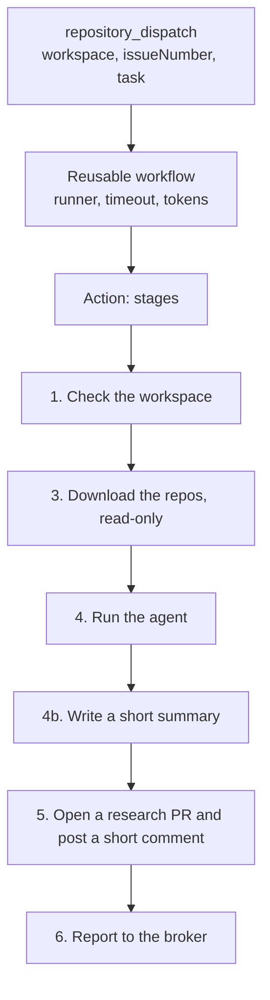
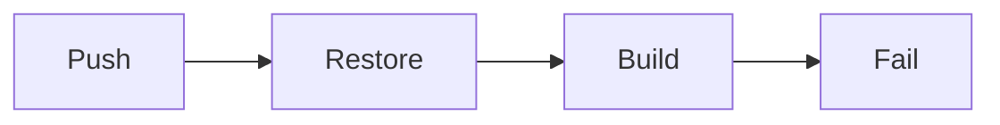

# rpi-workflow

A reusable GitHub workflow and Action. An organization adds one small file to its workspace repo. We run the rest.

Status: version 0. It runs research in a workspace repo and posts the result on the workspace issue. It does not report to the broker. It does not run the rpi skill yet.

## What an organization adds

One file in the workspace repo, on the default branch:

One file for every phase. The command (research, design, outline, ...) is in the payload, so a new phase needs no new file.

```yaml
# .github/workflows/slopfactory.yml
name: slop factory
on:
  repository_dispatch:
    types: [slopfactory-run, slopcodebot-research]   # the second is the old broker event; it means research
permissions:
  contents: write
  issues: read
  id-token: write   # the last step proves its identity to the broker
jobs:
  run:
    uses: TheCloudPlumbingCo/slop-factory-pieces/.github/workflows/workspace.yml@main
    with:
      model: claude-haiku-5.5   # light model for tests; remove the line to use the CLI default
    secrets: inherit
```

Once a `v1` tag exists, replace `@main` with `@v1`.

`claude-haiku-5.5` is a light model. A local Copilot CLI 1.0.54 answered with it. The model id `claude-haiku-5-5` (dashes) is not accepted. Model lists change, so check the id with `/model` in the CLI.

The organization also needs:

| Item | Where | Why |
| --- | --- | --- |
| `COPILOT_GITHUB_TOKEN` | secret | The Copilot CLI signs in with it. |
| `workspaces/<id>/workspace.json` | workspace repo | Lists the repos and the project number. The broker reads the project number to move the card. |

Example `workspace.json`:

```json
{
  "name": "be",
  "repos": ["acme/core", "acme/tea-service"],
  "project": 4
}
```

## What a run does



| Stage | Script | Notes |
| --- | --- | --- |
| 0 | `scripts/resolve-command.sh` | Checks the command. Rejects an unknown or unsupported command. This is where a new phase is added. |
| 1 | `scripts/check-workspace.sh` | Fails with a short message when the workspace id or folder is wrong. |
| 2 | none | The broker moves the board card. The workflow never names a column. See "The board card". |
| 3 | `scripts/clone-repos.sh` | Removes `.git`, so the agent cannot push. |
| 4 | `scripts/run-agent.sh` | Decides what to ask. `scripts/agent.sh` is the only file that names the agent. Today: the Copilot CLI. `scripts/build-prompt.sh` builds the prompt. |
| 4b | `scripts/summarize.sh` | Runs only when the research worked. Asks the agent for a short summary with diagrams. Never fails the job. |
| 5 | `scripts/publish.sh` | Runs even when an earlier stage failed. Commits the full research file, opens the PR, and posts a short comment. On failure it posts the failure message. |
| 6 | `scripts/report.sh` | Runs even when an earlier stage failed. Sends `complete` or `fail` to the broker with an identity token. Sends nothing when the payload has no `deliveryId` (a manual dispatch). Never fails the job. |

`scripts/guard-output.sh` withholds agent output that looks like an access token. It runs on the research and on the summary.

## The board card

The broker moves the card. The workflow does not, and it has no board token.

- The broker keeps a small table: command and event give the next column. The code is `packages/core/src/CardStates.ts`.
- Events are `HandedOff`, `Succeeded`, and `Failed`. Today only one rule exists: `research` and `HandedOff` give `Research`.
- The broker applies the rule right after GitHub accepts the dispatch. It reads the project number from `workspaces/<id>/workspace.json`. The move runs in the background. A problem is logged and never fails the delivery.
- A research success or failure does not move the card. A person merges the research PR, and the workspace repo's `board-sync.yml` then moves the card to Design.
- A card never moves to the left. A card that is not on the board is added first.
- The workflow only reports `complete` or `fail`. To change a column rule, change the table in the broker.

## What the comment shows

The full research is in a file in the research PR. People read it there and comment on its lines. The issue comment does not repeat it. The comment is short, with diagrams that GitHub renders:

````markdown
The cache key is stale, so CI restores old files.

- The key is set in `be-api/.github/workflows/ci.yml:12`.
- It does not include the lock file hash.



---
Research file: https://github.com/acme/ws/blob/be/research/issue-42/workspaces/be/research/issue-42.md
Research PR: https://github.com/acme/ws/pull/7
````

The PR description holds the same short text. It keeps the line `Refs #<issue>` and the line "Merging this PR approves it."

`scripts/publish.sh` checks the summary before it posts it:

| Check | If it fails |
| --- | --- |
| The summary exists and is not empty | Short fallback |
| It is 8000 characters or fewer | Short fallback |
| `guard-output.sh` finds no token | Short fallback |
| Each `mermaid` fence is closed, starts with a known diagram word, and is one of the first 2 | That diagram is dropped. The text stays. |
| Any other code fence is closed | The fence is closed for you |

The short fallback is the first heading and the first 10 lines of the research, with the two links. It is never the full text.

If no PR can be opened, the comment holds the full result, cut to fit. The user still gets the answer.

## The summary prompt and the show-me rules

`scripts/summarize.sh` builds the prompt. It holds the rules for the summary, the research (cut to about 90 KB), and the text of the `show-me` skill. The skill text is in `skills/show-me/SKILL.md`.

- The file is a trimmed copy of `show-me` from `humanlayer/skills`, pinned to commit `4d69d20f6e9b57b4fcf0d501ccfb1be961f0f329`. The header of the file names the source and the licence (MIT).
- The HTML page and the `open` step are removed. A comment cannot show HTML, and the runner has no browser.
- The copy is in the repo, so the Action does no download at run time. A change in the upstream repo cannot change our output until someone reads it and updates the copy.
- The text goes into the prompt, not into a skills folder. The Copilot CLI can load skills from `~/.copilot/skills` or `.github/skills`. But it must find the skill and choose it, and that is not certain. The prompt is certain.

## Payload

The workflow reads these fields from `github.event.client_payload`:

| Field | Use |
| --- | --- |
| `command` | What to run. Today only `research`. Missing means `research`. An unknown command gets a comment on the issue. |
| `workspace` | Workspace id. |
| `issueNumber` | The workspace issue. Its title and body are always the base input. It also gets the result. |
| `task` | Optional extra instructions: the text after the command. They are added to the issue title and body, never instead of them. |

| `deliveryId`, `brokerOrigin` | Sent by the broker. Stage 6 uses them to report the end of the run. The broker then replies on the channel the comment came from. The workflow does not know the channel. |

## Limits to know

- A reusable workflow cannot get more permission than its caller. The `permissions` block stays in the caller's file.
- A reusable workflow cannot use `uses: ./...` for an Action. The path would point into the caller's repo. The workflow uses the full path with `@main`.
- `repository_dispatch` runs only from the default branch.
- The report needs two settings outside this repo. The caller file grants `id-token: write`. The broker setting `OIDC_ALLOWED_WORKFLOW_REF` holds `TheCloudPlumbingCo/slop-factory-pieces/.github/workflows/workspace.yml@refs/heads/main`. Without them the broker refuses the report and the delivery times out. The result is still on the workspace issue.
- A run that dies or is cancelled sends no report. The broker needs a watchdog for that case.
- A Mermaid diagram can still fail to render if a label has odd characters. The check only finds broken fences. GitHub then shows the diagram source as an error box. The text around it is fine.
- The summary is a second agent call. It adds a few seconds and a small cost to each run.
- The summary says only what the research says. The prompt asks for this. Nothing checks it. Read the file in the PR for the full truth.

## Next

- Replace `scripts/run-agent.sh` with the Copilot SDK runner and the pinned rpi skill.
- Add the design and outline commands to `scripts/resolve-command.sh`.
- Add `repo.yml` for the implement command, run in the original repo.
- Send `slopfactory-run` with a `command` field from the broker, then drop the old event type.

## Tests

```sh
../../node_modules/.bin/vitest --run
```

The tests run the scripts in temp folders. They use local git repos and a fake `gh`. They do not call GitHub.

## The prompt

`scripts/build-prompt.sh` builds it. The input is the issue plus the optional instructions:

```text
You are doing read-only research for the '<workspace>' workspace. Its repositories are cloned under ./repos/ ...
Reply with markdown only: a one-line answer first, then the evidence ... 'Affected repos' ... 'Open questions'.

## Issue #<number>
Title: <issue title>

<issue body>

## Additional instructions      <- only when the comment has text after the command
<instructions>
```

If the issue cannot be read, the prompt says so and still carries the instructions.
