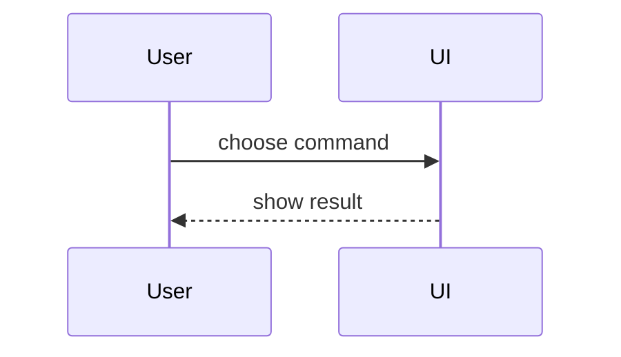

<!--
Vendored, trimmed copy of the `show-me` skill.
Source:  https://github.com/humanlayer/skills/blob/4d69d20f6e9b57b4fcf0d501ccfb1be961f0f329/plugins/show-me/skills/show-me/SKILL.md
Commit:  4d69d20f6e9b57b4fcf0d501ccfb1be961f0f329 (humanlayer/skills, main, resolved 2026-11-08)
License: MIT, Copyright (c) 2026 HumanLayer. See https://github.com/humanlayer/skills/blob/4d69d20f6e9b57b4fcf0d501ccfb1be961f0f329/LICENSE
Changes:  removed the HTML artifact option and the `open` step (no screen and no browser here), removed the front
          matter, shortened the examples. scripts/summarize.sh puts this text into the prompt. Update it by hand
          after reading the upstream change. Do not fetch it at run time.
-->
Help the reader understand the topic visually. Skip the preamble and keep prose brief. Pick the smallest view that makes the key point clear. The result goes into a GitHub comment, so use only views that GitHub renders in Markdown.

- Show logic or an algorithm as pseudocode:

```text
on(save)
  if content is unchanged
    return cached result
  write new content
```

- Show runtime control flow as a call tree:

```text
submitForm
  createSession
    launchAgent
  navigateToSession
```

- Show file responsibility or a broad refactor as a shallow file tree:

```text
src/
├── commands/       # parses user actions
└── sessions/       # owns session state
```

- Show component interaction, control flow, or data flow with Mermaid:



- Use `diff` when the point is what changes and the surrounding shape already exists:

```diff
 on(save)
-  write content
+  if content is unchanged
+    return cached result
+  write new content
```

- Show the whole block when most of it is new, or when omitted context would hide ownership or order.

### guidance

Place each visual next to the short text it supports. Keep only the calls, files, states, and boundaries needed to answer the question. You may use one of these, you may use several, it is unlikely you will use all of them. Do not overwhelm the reader.
